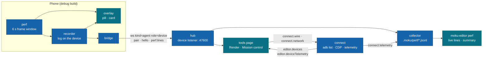
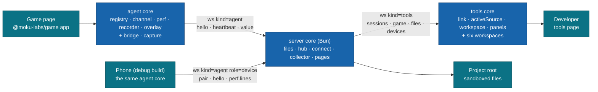
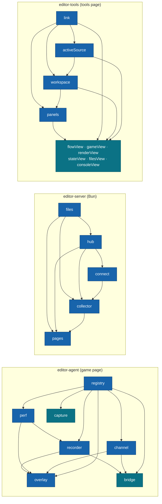
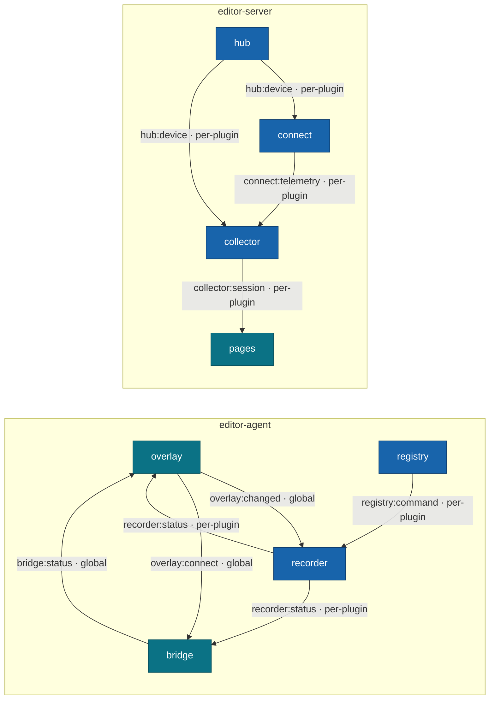
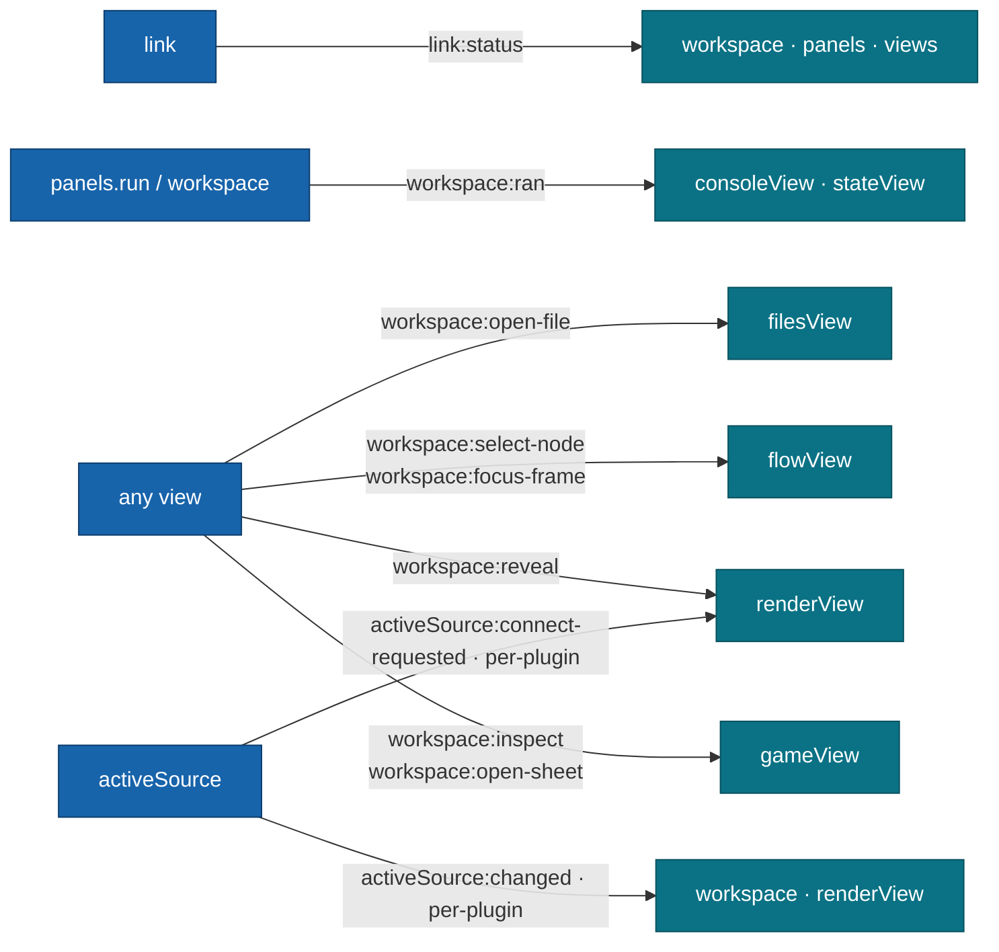

# @moku-labs/editor

**Devtools for a running `@moku-labs/game`: see the flow, the state, the render and the files of the live game, and change them, from one tools page.**

One registry of sources and commands feeds everything: the in-game overlay, the tools page served by the dev server, MCP and headless tests. On a phone, a debug build carries the same agent: a frame graph that names each spike's cause, a log on the device, and `moku-editor perf` on the computer. The Render workspace, Mission control, shows one source at a time: the local preview, or a phone you connect from the editor by wire or on the network. The editor reaches the game only through its two doors, `@moku-labs/game/inspect` and `@moku-labs/game/control` — no private hooks into the engine, no engine fork. It is a dev dependency, not a runtime: nothing of it ships in a release build (see [Production builds](#production-builds)).

<br/>

[](https://www.npmjs.com/package/@moku-labs/editor)
[](#requirements)
[](#requirements)
[](#install)
[](https://github.com/moku-labs/core)
[](./LICENSE)

<br/>

[Install](#install) · [Quick start](#quick-start) · [Use with Claude Code](#use-with-claude-code) · [The tools page](#the-tools-page) · [On a phone](#on-a-phone) · [Production builds](#production-builds) · [How it works](#how-it-works) · [The three cores](#the-three-cores) · [Plugins](#plugins) · [Configuration](#configuration) · [Events](#events) · [Wire protocol](#wire-protocol) · [Scripts](#scripts) · [Docs](#docs)

---

## Why @moku-labs/editor

- **One registry, every surface.** A source or command is declared once in the agent's `registry`; the overlay, the tools page and a test all read it the same way — through an `EditorChannel`. No second code path to keep in sync.
- **Doors, not hooks.** The editor touches the game only through `@moku-labs/game/inspect` and `@moku-labs/game/control`, plus the game's own `.dev` modules. If the engine does not expose it, the editor does not see it.
- **Three runtimes, three cores.** The game page, the Bun server and the tools page each get their own Moku core with their own events (`editor-agent`, `editor-server`, `editor-tools`). Bun code never reaches the browser; Preact never reaches the server.
- **A panel is data.** `definePanel` returns a frozen spec of sources, commands and a view. The `panels` host owns every subscription, stale marking and teardown — views never poll.
- **Edits keep the game state.** With Bun hot reload on (the bin's default), a save of a game source reloads the game page and the bridge restores the bookmark it took just before: "Game reloaded · state restored", in about a second on merge-game. With `@moku-labs/game` 0.5.0 and its hot swap plugin in the game's `bunfig.toml`, a save of a view module (styles, components, strings) swaps in place without a reload: "Game updated". Without hot reload the editor bookmarks, reloads the frame and restores it itself (D-07). Only the game reloads: the editor does not move, and one spinner on the game frame shows the reload.
- **A cockpit on the phone.** A debug build (`moku-game build --debug`) carries the agent with its overlay: fps and spikes in a pill, a 6 s frame graph that names the cause of each spike, and a log on the device once someone records. `moku-editor perf` on the computer pairs the phone, keeps its logs and compares two runs (see [On a phone](#on-a-phone)).
- **Mission control, one source at a time.** The Render workspace reads exactly one source: the local preview, or a phone. Connect device links a phone from the tools page, by wire (Android over adb) or on the network, and the local preview pauses while the phone is the source. A 2-minute frame timeline, the shaders and passes, memory and device load all come from that one source (see [The Render workspace](#the-render-workspace-mission-control)).
- **Loopback and sandboxed by construction.** The server binds `127.0.0.1` only, checks Host, Origin and a per-start token before any upgrade, and `files` reads and writes only inside one project root and an allowlist. Device mode adds one listener on `127.0.0.1:47600` for phones by wire and, on request (`moku-editor perf --lan`, or On the network in the tools page), one LAN listener that takes nothing but the sockets of paired phones (a four-digit code typed in the terminal or the tools page). The server runs no shell; it spawns `adb` only while device mode runs or the Connect panel lists phones (the collector's `adb reverse`, connect's phone list and wired telemetry). The MCP bridge starts the bin when none runs, and stops only that one.

## Install

```sh
bun add -d @moku-labs/editor @moku-labs/game typescript
```

In a moku-game folder (`index.ts` and `config.ts`, the game `moku-game dev` runs), that is all. Run the editor in the folder:

```sh
bunx moku-editor --root .
```

The engine writes the dev page with the editor's page agent on it, so the game needs no HTML file, no dev entry and no `bunfig.toml` of its own (see [Quick start](#quick-start)). A game with its own HTML page wires the agent itself and passes the file.

> [!NOTE]
> **Status: `0.x` — early.** The API can change between minor versions. `@moku-labs/game >= 0.15.0` and `typescript >= 5.5` are **required peer dependencies**: the editor finds game code through the game's [project index](#project-index), and the bin takes a moku-game's page and its keys watch from the engine's `@moku-labs/game/cli`.
>
> **Breaking in this change:** the project index is the only source of code locations. See [Breaking](#breaking-the-project-index) for what was removed.
>
> **Breaking (phone tools, unreleased):** the agent has two more default plugins, `perf` and `recorder`, and a new `overlay`; a game's dev entry keeps working unchanged. `pluginConfigs.overlay.open` and `corner` are `mode` and `dock` (the old keys throw a `TypeError` naming the new field); `editor.overlay` takes `{ mode: "hidden" | "pill" | "card" }` instead of `{ on }`; the overlay's one-click cheat buttons are gone: a game marks its own `.dev` commands `overlay: "button"` or `"toggle"`. A custom server composition with `pagesPlugin` composes `collectorPlugin` before it (the server entry's defaults do). `bridge:status` gains the optional `link`. The phone tools need the engine release with the renderer monitor (see [On a phone](#on-a-phone) and [Requirements](#requirements)).
>
> **Breaking (Mission control, unreleased):** the server core has one more default plugin, `connect`, and the tools core one more, `activeSource`. A custom server composition with `collectorPlugin` composes `connectPlugin` between `hubPlugin` and `collectorPlugin` (the collector hooks `connect:telemetry`); a custom tools composition with `workspacePlugin` or `renderViewPlugin` composes `activeSourcePlugin` right after `linkPlugin`. The recorder starts no log by itself: `recorder.autoStart` is `false` (a game that wants a log from launch sets `"device"` or `true`), and `editor.record` takes `{ on?, label?, mark? }` and answers `{ on, file, startedBy, marked }`. `renderView.fpsSamples` is removed, and so are `renderView.device()`, `stepSpike`, `openSpike`, `closeSpike` and `setMore` with the device strip: Render is Mission control (`mission()`, `inspect()`, `select`, `step`, `jump`, …). `WorkspaceApi` gains `startLocalPreview()`. The Game workspace reads no scene from a phone.
>
> **Breaking (editor UI cleanup):** Reference mode is gone: key R, the top-bar toggle, `workspace.reference()` and `setReference()`, the event `workspace:reference` and the `data-moku-*` proxies over the game. The element picker (the Select button of the Game toolbar, ⇧⌘C, I) is the one way to pick. A click of the picker writes the reference and copies its line only while the "Copy Ref" switch of the Game toolbar is on (the default; the preference "Copy reference on select"). With it off the click only selects the element and writes nothing. The Flow Inspector has two tabs, Info and Code: its Styles tab, the palette group "Styles" and the config key `flowView.styleSaveDelayMs` are removed. A series no longer opens the contact sheet when it ends.
>
> **Doors:** the views read element rects from `game.locate` when the game lists it (0.4), else from `game.rect` (0.1); a game with neither makes the picker say "This game reports no element rects". `game.capture` may answer the PNG data URL (0.1) or `{ png, legend? }` (0.4): `editor.capture`, `editor.series` and the Game Shot and Series take both. The contact sheet `editor.sheet` (MCP `moku_series`) needs game 0.4.
>
> **Breaking in this release:** Notes are gone (`flowView.notes`, the gameView attach api, the `notesDir` options of flowView and gameView, the `workspace:new-note` event). Game is the default workspace, and ⌘1 to ⌘6 follow the new rail order. `hub.allow` is now `hub.allowOrigins` (`files.allow` keeps its name). The flowView layout, zoom and hub options moved into the objects `layout`, `zoom` and `hub` (for example `layoutWorker` is `layout.worker`); an object you pass replaces the default object as a whole. Captures go into day folders `<capturesDir>/<yyyy-mm-dd>/` (local date): a Shot is `0846-board.jpg` there (was `2026-10-05-0846-board.jpg`), a series `series-1015/` (was `series-2026-10-05-1015/`); picks and cards keep their names. Old flat files stay where they are; `moku_reference` finds cards in both.
>
> **Breaking since 0.0.3 (round 2, unreleased):** the bin serves with Bun hot reload on (`--no-hmr` starts it off; the Hot reload switch flips it while the bin runs). A pick and "Copy reference" put [one reference line](#the-reference-line-and-card) on the clipboard; the full reference block moves into the card file `<key>-f<frame>.md` the line names, and `gameView.copyReference()` returns the line. A pick also saves `<key>-f<frame>-crop.jpg` and `f<frame>-full.jpg` in `capturesDir`, which must be `.moku/captures` or a folder under it. Screenshots are JPEG by default: `editor.capture` and `editor.sheet` take `format` (`"jpeg"` or `"png"`) and `quality`, and the Game Shot saves a `.jpg`. The Game toolbar lost its Overlay switch: the top bar has it. Device preset ids are unchanged; fifteen presets are new, and a fresh viewer starts on the iPhone 18 Pro. `DeviceSpec` gains `frame`. Fit uses one scale per device kind. The capture card's meta line reads `f<frame> · <device>`.

> [!IMPORTANT]
> The server core and the `moku-editor` bin run on **Bun** (`Bun.serve`, HTML imports). The agent and tools cores run in the browser. The package is **ESM only**.

## Quick start

**A moku-game folder** (`index.ts` and `config.ts`, no `web/`) needs one command, run in the folder:

```sh
bunx moku-editor --root .
```

```
Game   http://127.0.0.1:3000/
Tools  http://127.0.0.1:3000/__editor/
Root   /home/dev/timber
```

The bin asks the engine for the dev page (`preparePage` of `@moku-labs/game/cli`, resolved from the game folder) with the editor's page agent `@moku-labs/editor/agent/page` on it. It also starts the engine's keys watch (`watchKeys` of the same `cli`), so `generated/` is fresh before the page is served and stays fresh: a saved string shows without a `moku-game keys` run, and a failed scan is one warning. Then it runs again under the page's `.moku/bunfig.toml`, so Bun loads the engine's hot plugin; the watch stops when that run ends. The page starts the agent with bridge and capture after the game started and sets `globalThis.editor`. There is nothing to wire.

| Flag | Default | What it does |
|---|---|---|
| `--root`, `-r` | `.` | The game folder, or the project root the editor reads and writes. |
| `--port`, `-p` | `3000` | Port on 127.0.0.1. `0` picks a free port. |
| `--no-hmr` | hot reload on | Serves the game without Bun hot reload. |
| `--packed` | loose files | Serves `dist/assets` from `moku-game pack`, as `moku-game dev --packed` does: a big game loads far faster, there is no keys watch, and new art shows only after the next pack. No pack is an error. |
| `--preload FILE` | | A file Bun preloads in the serving process. Repeatable. Engine page only. |
| `--serve-plugin FILE` | | A Bun plugin the engine page bundles with, after the engine's hot plugin. Repeatable. Engine page only. |

`--preload` and `--serve-plugin` paths are relative to the working directory. An editor working tree adds its own `scripts/tree/bundle.ts` to the serve plugins: the page bundles the tree's build on the game's one copy of the engine. An installed editor never adds it.

`bunx moku-editor e2e -c <playwright config> [playwright args…]` runs a game's editor Playwright specs with one Playwright process per project and spec file, so each spec file gets a fresh editor bin: Bun's dev server degrades after many hot reloads in one process (D-52, D-53). One `--list` run with your words makes the plan, so `--project`, file arguments and `-g` / `-G` narrow it. Each (project, file) pair then runs with `--project=<name>`, an anchored regex of the file and `--pass-with-no-tests`, on its own `PORT` (`PORT`, else 4417, plus the run's index). Every other word goes to each run; `--reporter` skips the list run, `--shard` and `--last-failed` act on the list run only. After each run one line reports it, `chromium-desktop · layout.spec.ts · passed · 12.3 s`, and a summary closes: `e2e: 21 runs · 0 failed · 640.2 s`. A failed run's line and a failing summary print as errors; a warning names the tests of an unnamed project that did not run. A `--list`, or words that match no test, run once as given. `--project a b` takes every next word that does not start with `-`, as Playwright does, up to a word that looks like a path (a `/`, or `.ts`, `.tsx`, `.js`, `.mjs` at the end): `--project desktop tests/browser/files.browser.ts` runs that file in desktop; a project named like a path needs `--project=<name>`.

A run takes `.moku/e2e.lock` in the working directory with its pid, so two runs never overlap: while a live run holds it, a second run prints "[moku-editor] another e2e run (pid N) holds .moku/e2e.lock: wait for it, or delete the file when no run is left" and exits 1; a lock of a dead pid is taken over, and the run removes its lock when it ends. A `--list` takes no lock.

**A game with its own HTML page** has three pieces: the **agent** on the game page, the **server** in Bun, the **tools page** in a browser tab.

**1. Wire the agent into the game page — dev only.** The default agent plugins are `registry`, `channel`, `perf`, `recorder` and `overlay`. The websocket `bridgePlugin` and the screenshot `capturePlugin` are opt-in, so a dev entry adds them behind the engine's dev flag:

```ts
import { bridgePlugin, capturePlugin, createApp } from "@moku-labs/editor/agent";

const devPlugins = __MOKU_GAME_DEV__ ? [bridgePlugin, capturePlugin] : [];
const editor = createApp({
  plugins: devPlugins,
  pluginConfigs: { registry: { game: app, modules: [mergeDev], name: "merge-game 0.0.0" } }
});
await editor.start(); // never waits for the editor server
```

`app` is the game made with `createApp` from `@moku-labs/game`; `modules` are the game's `.dev` modules (extra sources and commands). `__MOKU_GAME_DEV__` is the engine's dev flag: a dev build defines it `true`. Start the editor after the game: the registry probes the game's sources at start. For a game that ships, use the entry in [Production builds](#production-builds), which keeps the whole agent out of the production bundle.

**2. Run the server.** The quickest way is the bin with the game HTML file — it serves it with the editor mounted:

```sh
bunx moku-editor web/index.html --port 3000 --root .
```

```
Game   http://127.0.0.1:3000/
Tools  http://127.0.0.1:3000/__editor/
Root   /home/dev/game
```

Hot reload is on: Bun reloads the game page after a save, and the game comes back where it was (see [Hot reload](#hot-reload)). The **Hot reload** switch of the tools page turns it off and on while the bin runs; `--no-hmr` starts the bin with it off. `bunx moku-editor --help` lists every flag.

Or wrap the game's own `Bun.serve` with the server core:

```ts
import { createApp } from "@moku-labs/editor/server";
import index from "./index.html";

const editor = createApp({ pluginConfigs: { files: { root: `${import.meta.dir}/..` } } });
await editor.start();
Bun.serve(editor.hub.serve({ port: 3000, routes: { "/": index }, fetch: serveAsset }));
```

**3. Open the tools page** at `http://127.0.0.1:3000/__editor/`. It ships prebuilt in `dist/tools/` and embeds the game at `gameUrl` (default `/`). The link pill goes `connecting` → `live · frame N` as soon as the game page's bridge says `hello`.

**In a narrow pane.** The tools page is built to sit next to a chat, in Claude's browser pane at
1/2 (720 px) or 1/3 (480 px) of the screen. Game is the first workspace and the default
(⌘1 Game, ⌘2 Flow, then Render, State, Files, Console). Density is `auto` (compact below 820 px of
window width), `compact` or `comfortable`, chosen in the palette or the ⋯ menu ("Density: …") and
saved with the theme. Below 900 px the [top bar](#the-top-bar) is compact. **The element picker**
(the Select button of the Game toolbar, ⇧⌘C or I) is the one way to pick. While it is on, the
cursor over the game is a crosshair. A click on an element copies its
[reference line](#the-reference-line-and-card) for the chat and writes the card file that line
names, and a drag picks [an area](#an-area) with every element inside it. Turn the **Copy Ref**
switch of the Game toolbar off to only look: a click then selects the element for the Element tab
and writes nothing.

> [!TIP]
> The tools page is itself a Moku app (`src/plugins/pages/page/main.tsx`). To compose your own, start the tools core and mount the shell:
> ```ts
> const tools = createApp({});
> await tools.start();
> tools.workspace.mount(document.querySelector<HTMLElement>("[data-editor-root]")!);
> ```

## Use with Claude Code

`moku-editor mcp` is a stdio MCP server. Claude Code starts it. It uses the running editor, or starts one, and gives Claude 22 generic `moku_*` tools: read the game, wait for a value, run commands, take screenshots, read and make the editor's selection, set its device and workspace, switch hot reload, edit files and find keys of the project index. On top of them it lists one tool per command door of the connected game (see [Door tools](#door-tools)).

**1. Register it** from the game folder:

```sh
claude mcp add moku-editor -- bunx moku-editor mcp web/index.html --port 3000
```

Or commit a project `.mcp.json`. `bunx moku-editor mcp-config web/index.html --port 3000` prints it:

```json
{
  "mcpServers": {
    "moku-editor": {
      "type": "stdio",
      "command": "bunx",
      "args": ["moku-editor", "mcp", "web/index.html", "--port", "3000"]
    }
  }
}
```

`claude mcp list` then shows `moku-editor: … ✔ Connected`.

**2. Ignore the editor's files.** The bin writes `.moku/editor.json` (its port and the per-start token, mode 0600). A bin the bridge starts logs to `.moku/editor.log`. Add `.moku/` to the game's `.gitignore`.

**3. Keep the game page visible.** Open the game or the tools page in a browser, or in Claude's browser pane. Screenshots and contact sheets need the page on screen: a paused game or a hidden tab answers "game paused or hidden at frame N — bring the editor pane to front or resume", not a timeout.

Which editor the bridge uses:

- A running bin wins. The bridge finds it through `.moku/editor.json` under `--root` (default the working directory).
- No bin runs: the bridge starts `moku-editor <html> --port <port>` itself, with the html and port it was given. In a moku-game folder (`index.ts` and `config.ts`) it needs no html: it starts the engine page.
- Claude Code closes (stdin end, SIGINT or SIGTERM): the bridge stops the bin it started. A bin you started yourself keeps running.

| Tool | What it does |
|---|---|
| `moku_status` | Is the editor running, did the bridge start it, URLs, hot reload, sessions. Call it first. |
| `moku_sessions` | The connected games, each with `heartbeat { frame, paused, silent }`. |
| `moku_manifest` | The game's sources and commands: ids, inputs, effects. |
| `moku_read` | Reads a source, such as `game.position`. |
| `moku_wait` | Waits until a source equals a value, leaves a value, or changes (at most 25 s). |
| `moku_run` | Runs a command, such as `game.pause`. The answer starts with its effect. |
| `moku_screenshot` | A JPEG of the game, at most 1080 px wide by default. `key` crops it to one ui element; `format: "png"` keeps it lossless. Over 300 KB it is taken once more at half the width. |
| `moku_series` | A contact sheet: 2 to 12 frames, `everyMs` of game time apart, on one JPEG at most 1080 px wide. Game 0.4. |
| `moku_reference` | The newest or a named reference card with its crop: the day folders `.moku/captures/<yyyy-mm-dd>/` and the older flat `.moku/captures/`. |
| `moku_selection` | What is selected in the editor page: key, name, type, `file:line`, rect, card, crop and the reference line, with the crop image. `edits` lists the pending style edits of the element, `{ path, from, to }` each, to apply in the source. An edit of a text's style key has the path `textStyle:<key>#<field>`. |
| `moku_select` | Selects an element by `key`, or an area by `rect`, in the editor page. The page shows the selection; the answer is the selection with its card and crop. With `node` it selects a node of the flow graph: the page opens the Flow workspace and focuses the node; the answer is `{ id, selected, places }`, the places being the node's files and lines. Needs the tools page open. |
| `moku_device` | Reads or sets the device of the tools page: `preset`, `orientation`, `folded`. The answer carries the game viewport `w` × `h` after the change and the presets to choose from. Needs the tools page open. |
| `moku_show` | Switches the tools page to a workspace: `flow`, `game`, `render`, `state`, `files` or `console`. Without one it reads the active one. Needs the tools page open. |
| `moku_files_list` | Lists project files. |
| `moku_files_read` | Reads a file and its version. |
| `moku_files_write` | Writes a file, with an optional version check. |
| `moku_files_find` | Where a key of the project index lives, such as `node:board/merge` or `jsx:coins`: file, binding, line and the file's version. |
| `moku_project` | The project index the editor keeps: the key count per kind, the keys of a `prefix` with their files, or what one file (`path`) defines and uses. |
| `moku_reload` | Reloads the game page and restores its state. |
| `moku_hot_reload` | Switches Bun hot reload on or off. The editor restarts its server; the call returns once it is back, at most 15 s. Call `moku_reload` after it. |
| `moku_start` | Starts the editor when it does not run. A moku-game folder needs no html: the engine page starts. |
| `moku_stop` | Stops the editor, only when the bridge started it. |

Every game tool takes an optional `session`. The file tools stay in the files sandbox and never show or touch `.moku/editor.json` or `.moku/editor.log`. The bridge never prints the token. Detail: [pages README, MCP bridge](src/plugins/pages/README.md#mcp-bridge-mcp).

### Door tools

After the 22 generic tools, `tools/list` holds one tool per command door of the selected session. Each has a typed input schema, so Claude does not guess `input` for `moku_run`. Sources stay behind `moku_read`.

- **Name.** The door id with `.` as `_`: `game.tap` is `game_tap`. Cheat and raw doors carry the effect first: `cheat_game_fill`, `raw_game_restore`.
- **Input.** One property per door field (`string`, `number`, `boolean`, `json`); fields without `?` are required. The optional `_session` picks another session.
- **Answer.** The same as `moku_run { id, input }`: `effect: <effect>`, then `{ value, frame, state }`.
- **Selected session.** The one `moku_run` uses without `session`: the only one, else the embedded one. Several sessions and none embedded: no door tools.
- **No tool.** The doors the generic tools cover: `game.capture`, `editor.capture`, `editor.sheet`, `editor.series`, `editor.seriesStop`, `editor.reload`. Screenshots go only through `moku_screenshot`: JPEG by default, about 300 KB at most. Also no tool for a name that starts with `moku_` or is longer than 40 characters, an id outside `[A-Za-z0-9._-]`, a field named `_session` or outside `[A-Za-z0-9_-]{1,64}`, or two doors with the same name. The bridge logs each one once on stderr; `moku_run` still runs it.
- **Change.** The hub stamps `manifestHash` (the hash of the game's commands) on every session. The bridge rebuilds the door tools, and sends `notifications/tools/list_changed`, only when that hash moves. A hot reload of the same game and the bin's restart (the Hot reload switch) keep the list: it stays 8 s while no session is chosen or the hub socket is closed, and the bridge reconnects 0, 1, 3 and 7 s after the close. The first `tools/list` waits at most 3 s for the door tools.

Deny the cheat and raw doors in Claude Code settings:

```json
{ "permissions": { "deny": ["mcp__moku-editor__cheat_*", "mcp__moku-editor__raw_*"] } }
```

A client that does not refresh its list after `list_changed` keeps the old door tools. A door that is gone answers `isError`. `moku_run` runs every door.

## Project index

The editor does not guess where game code lives. It asks the game's **project index**
(`@moku-labs/game/project`, game 0.7.0 and newer). The server core's `files` plugin opens the
index of its root on start (`openProject({ root })`, about 150 ms on merge-game, not awaited) and
keeps it fresh with the index's watch. The bin prints `files:project-on { files, keys, ms }` once it
is open.

The tools page reads it two ways:

- **Lines:** the files-channel request `find { key }` (`link.files.find(key)`). Each answer carries
  the path, the line and range read from disk at the call, and the `hash` of the bytes, which equals
  the files `version`.
- **Key maps:** the published state `editor.project` (`link.project()`, event `link:project` with a
  `ProjectDelta`): on or off, the revision, the manifest path, key → def paths, key → use paths,
  broken files and the last change. JSX keys never ride the state; only `find` reaches them.

Every view asks the index first and only the index:

| View | Keys |
|---|---|
| Flow | `node:<flow>/<node>` (Code tab, file of a node) |
| Game | `jsx:<key>` (picked element and its JSX), `style:` (its style block), `projection:` (an entity), `textStyle:`, `component:` (area card) |
| Files | `flow:` and `node:` defs and their uses (Used by) |
| Game, Render | `ProjectState.manifest` (the asset manifest) |

Moves and edits by agents while the editor is open are followed. A watch batch names the changed,
moved and removed files: open Files tabs follow a move ("Moved from nodes/catch-up.ts"), Used by and
the Code tab read again, and the views drop the caches the batch names.

**Requirements.** `@moku-labs/game >= 0.7.0` and `typescript >= 5.5` in the game repository (a game
already has `typescript` as a dev dependency). 0.7.0 brings the component, style and static JSX
keys the views ask for. The index needs no `bunfig.toml`: that file only
loads the hot swap plugin.

**What a view says:**

- `Project index is off: <reason>`: the index could not open (no `typescript`, a game before 0.7.0,
  `pluginConfigs.files.project: false` reads `disabled`). One line in every view that needs a code
  location. The server logs `files:project-off { reason }` at error. MCP and the game keep working.
- `Not in the project index: <key>`: the index has no answer for that key. No crawl, no guess.
- `The file does not parse now · fix it, then edit`: a style edit on a file the index marks broken
  writes nothing.

**Version check.** A write with a `version` compares it right before the rename, after the temp file
is written. A conflict answers -32005 and keeps the other bytes. An external write that lands
between that check and the rename is still overwritten: the window is narrowed, not closed.

### Breaking: the project index

- `@moku-labs/game >= 0.7.0` and `typescript >= 5.5` are required peers.
- The index is the only source of code locations. Removed: the kebab node → file rule and its root
  exports `nodeFile`, `flowFile`, `kebab`, `parseOverrides`, `SOURCE_ROOTS`, `SOURCE_OVERRIDES_PATH`
  and the type `SourceOverrides`; the source crawls of the style block, the projection, the text
  styles and the components.
- `.moku/editor/files.json` is ignored.
- Removed configs: `flowView.stylesFile`, `gameView.manifestPaths`, `gameView.sourceSearch`,
  `renderView.manifestPaths`. The manifest is `ProjectState.manifest`.
- The graph node field `file` (F-H2) is gone. `UsedBy.usedIn` is new. `StyleEditCode` gains
  `"broken"` and `"index-off"`.
- A key built in a loop answers the line of the element that builds it: `card0` is
  `features/orders/strip.tsx:216` (was `:157 (loop)`).

## The tools page

### The top bar

The bar picks its layout from the window width (`data-layout` on `[data-ui="top-bar"]`). No two
controls overlap at 480, 600, 640, 720, 899, 960 and 1440 px (`e2e/top-bar.spec.ts`).

| Width | The bar shows |
|---|---|
| 900 px and wider | The game mark, game name, source pill, session chip, the computer's engine fingerprint (from 1100 px), link pill, Pause, Step, the search box, the switches **Preview** (G), **Overlay** (O) and **Hot reload** (H) with their labels, Registry (an icon; the counts are in its title, "Registry · 20 sources · 23 commands"), theme. |
| Below 900 px | The game mark, game name, source pill (its name only), link pill (the session id is in its tooltip), Pause and Step as icons, the **Hot reload** icon (flame, a dot while on, H), a search icon and **⋯**. |
| 560 px and narrower | As below 900 px, without the game name. |

The bar starts with the **game mark**: the initials of the game name on a small tile coloured from
the name (`TT` for "Tic Tac Toe", `ME` for "Merge"), so two games in two panes are told apart at a
glance. The same name always gets the same colour. Without a game the tile shows `·`.

In the compact bar Pause and Step keep their labels as the accessible name and the tooltip. The
Hot reload icon toggle uses `aria-pressed`; it is inert with its reason in the tooltip when the
editor cannot change it.

The **⋯** menu (`data-action="more"`) holds, each toggle row with its state and its key: Game
preview (G), Overlay in game (O), Hot reload (H), then Registry (counts; opens the registry
popover), Density (auto → compact → comfortable) and Theme. Hot reload
stays in the menu while the bar shows its icon. A toggle row keeps the menu open. Esc, a second ⋯
click or a press outside closes it; ↑/↓ move through the rows. The Game toolbar has no Overlay
switch of its own.

The **source pill** names the page's one source (see [The Render workspace](#the-render-workspace-mission-control)): "Local preview", "Galaxy A26 · by wire" or "Galaxy A26 · on the network" for a phone, "<game> · another page"; its dot pulses while the source beats. A click opens the source menu: Local preview, every linked phone with Use, and Connect device…, which opens Render's Connect panel. When the active phone leaves, a notice under the top bar says so in every workspace ("Galaxy A26 disconnected. Showing the local preview.", Reconnect, Dismiss), the timeline gets the marker "Galaxy A26 disconnected here · Local preview resumed", and the page is back on the local preview. While a phone is the source, the local game frame is paused under a veil: "Paused · Galaxy A26 is the source." with Use local preview.

The preference **Copy reference on select** has no control in the top bar: it is the **Copy Ref**
switch of the Game toolbar (see [The Game workspace](#the-game-workspace)).

### The reference line and card

A pick (a click with the element picker: the Select button of the Game toolbar, ⇧⌘C or I)
bookmarks the game
(`game.bookmark`), saves the element and the whole frame as JPEGs in today's folder
`<capturesDir>/<yyyy-mm-dd>/`, writes a card file next to them,
puts one line on the clipboard and toasts "Reference, shot and bookmark copied". Paste the line
into the chat: it names the element, its flow node, its code, its place, and the card that holds
the rest. With the Copy Ref switch of the Game toolbar off, a click only selects the element:
nothing of this happens until you press "Copy reference" in the Element tab.

```text
@moku settingsBoard panel · settingsPopup/open · features/settings/settings.tsx:290 · ref 65,641 950×1060 · .moku/captures/2026-10-05/settingsBoard-f212.md
```

The card `<capturesDir>/<yyyy-mm-dd>/<key>-f<frame>.md` (`-2`, `-3` … when taken that day) is Markdown:

- a title `# @moku <name> <type>`;
- the full reference block in a `text` fence (below);
- `## JSX · <file:line>` and `## Style · <name> · <file:line>`, each a fenced snippet; for an
  entity, `## Spawned by <projection> · <file:line>` and its components;
- `` and ``.

The reference block says what the element is, where its code is, where it sits, and how to get the
game back to this moment:

```text
@moku settingsBoard · panel · settingsPopup/open · f212
path: settingsScreen/settingsBoard
source: features/settings/settings.tsx:290 · texture: ui.panel-signboard
layout: settingsScreen (column, padding 0/0/0/0)
bounds: 24,233 346×386 px · ref 65,641 950×1060
state: visible
flow: board > settings > open · last: board/settings/enter → done
game: merge-game 0.0.0 · s-1f12 · f212 · 15:31:13 · live · clean
device: iPhone 15 393×852 portrait · dpr 3 · safe 59/0/34/0
restore: bookmark settingsBoard-f210
shot: .moku/captures/2026-10-05/settingsBoard-f212-crop.jpg · frame: .moku/captures/2026-10-05/f212-full.jpg
```

| Line | Says |
|---|---|
| `@moku` | Name, type, flow/node of the game position, frame. |
| `path` | The ui path, or `entity #<id>` with up to 5 components. |
| `source` | `file:line` of the key from the project index (a key built in a loop answers the line of the element that builds it: `card0` is `features/orders/strip.tsx:216`), the style identifier with the `file:line` of its block, the nine-slice or texture. |
| `layout` | Up to 3 ui parents, nearest first: direction, padding and margin as `t/r/b/l`, gap. |
| `bounds` | The rect in device px, then in the game's reference units (`ref`). |
| `state` | visible or hidden, the true flags (pressed, disabled, selected), the text, alpha. |
| `flow` | The position stack, and the last edge with its frame. |
| `game` | Name and version, session, frame, time, live or paused, clean or tainted. |
| `device` | Preset, size, orientation, pixel ratio, safe insets. |
| `restore` | The bookmark id. `gameView.bookmarks()` keeps the last 20; `panels.run("game.restore", { bookmark: value })` goes back. |
| `shot` | The crop (`<key>-f<frame>-crop.jpg`, the element plus 8 px) and the full frame (`f<frame>-full.jpg`) in the day folder `<capturesDir>/<yyyy-mm-dd>/`. |

A line or a field that is not known is left out; a card that cannot be written leaves its path out
of the line. The Element tab does not show the block: it is in the card file. The footer of the
tab has two buttons, "Copy reference" and "Show in render tree". "Copy reference" writes the card
of the selection and copies its line; the same node and frame write the same card again. Shot and
Series copy `shot: <path>` and `series: <folder>/ (<n> frames)`.

#### An area

With the picker on, a press that moves 4 px or more drags a dashed marquee over
the game. The release
picks the area: the elements fully inside it (else the ones it covers by at least half of their own
area), group roots only, top to bottom then left to right, at most 40. The pick goes as for one
element: a bookmark, the area plus 8 px as `area-f<frame>-crop.jpg`, the full frame, the card
`area-f<frame>.md` in today's folder and one line on the clipboard. The picker then
turns off, like a click pick:

```text
@moku area 337×97 · main/home · 1 element · ref 77,1825 925×265 · .moku/captures/2026-10-05/area-f96.md
- playSign stack · key playSign · features/home/view.tsx:50 · 36,672 320×80 px · ref 100,1848 880×220
  - playPostLeft image · key playPostLeft · 87,687 17×120 px
  - playPostRight image · key playPostRight · 288,687 17×120 px
  - play button · key play · 36,672 320×80 px
    - playLabel text · key playLabel · 123,688 147×48 px
  - playSprigLeft image · key playSprigLeft · 14,658 62×67 px
  - playSprigRight image · key playSprigRight · 319,711 62×67 px
layout: playSign < homeCentre (column, gap 30) < homeMiddle (margin 0/0/44/0) < homeScreen (column, padding 0/0/0/0)
partly in the area: homeBackground image 0,0 393×852 px · homeTop column 0,0 393×852 px
```

The card's block lists one line per element (name, type, key, `text "…"` when the game reports
one, `file:line`, the bounds in px, `ref` rect). Under each element its child tree, two spaces per
level, 3 levels and 60 lines at most. Then one `layout:` line per parent chain, the
`partly in the area:` line (nodes that overlap the area but are not inside, at most 8), and the
`flow`, `game`, `device`, `restore` and `shot` lines. The code of every element with a
source follows (a known source line spends no new search), then `## <key> · component <Name> · <file:line>` for each component the area uses. A press that moves less is a click and picks the element under it. Esc during the
drag cancels it.

#### The selection over MCP

The tools page publishes what is selected (a pick, an area, nothing after Esc) to the editor
server, and Claude reads it with `moku_selection`. `moku_select { key }` or
`moku_select { rect }` selects from the chat: the tools page shows the element in the Game
workspace, picks it like a click (bookmark, crop, card, without the clipboard) and answers the
selection. The selection carries the pending style edits of the element (`edits`, see
[The Game workspace](#the-game-workspace)), so Claude reads what to change in the source.

### The Game workspace

- **Sound** (key M in Game, round 2b): a switch in the Game toolbar. It runs `game.mute { muted }`
  when the game's manifest lists `game.mute`, and keeps the flag with the viewer's preferences. A
  game that connects while the sound is off is muted again, so the flag survives a hot reload.
  A game without `game.mute` (before @moku-labs/game 0.4.4) dims the switch, title "Needs
  @moku-labs/game with game.mute".
- **Copy Ref**: a switch in the Game toolbar, after Safe area and Sound. It is the control of the
  preference "Copy reference on select", on by default and saved with the others
  (`workspace.copyOnSelect()`, `setCopyOnSelect(on)`). A palette command flips it too; it has no
  key. With it off, **Copy reference** in the Element tab still writes the card and copies its
  line on demand.

  | Copy Ref | A click of the picker | A drag of the picker |
  |---|---|---|
  | On (default) | Selects the element, writes the pictures and the card, copies the [reference line](#the-reference-line-and-card). | Picks [an area](#an-area). |
  | Off | Only selects the element for the Element tab. No file, no capture card, no clipboard. | Picks nothing. |
- **Select** (⇧⌘C or I): an icon button in the Game toolbar. It is lit while the picker is on: from
  the click until the pick completes, Esc or a second click.
- **Styles** in the Element tab: every value of the element's style is a field (a number, a text or
  a checkbox; one field per leaf of a record, such as `padding.top`). A change is kept as a pending
  edit. The editor does not write the file, and the game does not change until the source is
  edited. An edited row shows the old value struck through and a reset ×. Under the rows the edits
  bar counts them ("2 edits") and has "Copy for agent" and "Clear". "Copy for agent" puts one text
  block per element on the clipboard, the selected one first:

  ```text
  @moku homePlay · features/stage/views/home-screen.tsx:199
  minWidth: 556 -> 600
  padding.top: 25 -> 30
  ```

  The edits of the selected element also reach Claude through `moku_selection`
  (`SelectionInfo.edits`: each a `StyleEdit` `{ path, from, to }`, the values a `StyleValue`). An
  edit leaves by itself once the game shows its new value: the agent wrote the code and hot reload
  brought it in. From code: `gameView.editStyle(path, to)`, `clearEdits(scope?)`, `edits()` and
  `copyEdits()`.
- **Text style** in the Element tab: a text shows a second list, "Text style · ui.button", with
  the fields of its text style key, read from the game's text styles file. Under the title stand
  the `file:line` of the block and "Open in Files". A number and a quoted string are fields, like
  the Styles rows. Any other value, such as `colors.cream`, is read-only text. A change is a
  pending edit of the style key, not of the element: one key styles many texts, so every text with
  that key shows the edit. The edits bar counts it. "Copy for agent" writes it as a block of its
  own, after the element blocks:

  ```text
  @moku textStyle ui.button · shared/styles/text.ts:88
  size: 105 -> 96
  ```

  In `moku_selection` such an edit has the path `textStyle:<key>#<field>`, for example
  `textStyle:ui.button#size` or `textStyle:ui.button#shadow.dy`. It leaves by itself once the file
  has the new value, or once its field is no number or quoted string any more. Another value in
  the file becomes the `from` of the edit. The list needs
  @moku-labs/game 0.14.11 or newer, which sends the key of a text (`UiNode.textStyle`); with an
  older game it is not shown. A key the project index does not know shows
  `Not in the project index: textStyle:<key>`.
- **Code** in the Element tab: the JSX of the picked ui element, from the line that opens its tag
  to the line that closes it, and the `defineStyle` block of its `style={ident}`. Each snippet has
  its `file:line`, "Open in Files" and the shared highlighter; after 20 lines it shows "Show all N
  lines". The lines are the index's answer for the key. An entity shows "Spawned by
  <projection> · <file:line>" and its components with short values. A key the index does not know
  shows `Not in the project index: <key>`.
- **The capture card** after a Shot, a pick or a Series: a 56 px thumbnail, one line each for the
  title ("✓ Screenshot saved"), the path (cut in the middle, the whole path in its tooltip) and
  `f<frame> · <device>`, then Copy link (`shot: <path>`), Open and, after a pick, Reference (the
  line again). At most 360 × 120 px; in a 480 px window it takes the width less 24. A Series ends
  like a Shot: the card of its first shot, `series: <folder>/ (<n> frames)` on the clipboard and
  the toast "✓ N shots saved". The contact sheet of a series opens only on request: "Open contact
  sheet" in Files, or Open on the series card.

### Hot reload

The bin serves the game with Bun hot reload on. A save of a game source, by the editor or by an
agent writing the file, goes like this:

1. Bun tells the page it will reload. The bridge takes a `game.bookmark` and keeps it in
   `sessionStorage`, with the paused flag.
2. The new page restores the bookmark (and pauses again), then says hello with
   `manifest.restored`.
3. The tools page toasts "Game reloaded · state restored". It does not reload or restore a second
   time.

**Hot swap** (`@moku-labs/game` 0.5.0). A game that lists the game's Bun plugin in the
`bunfig.toml` of its root swaps a saved view module in place:

```toml
[serve.static]
plugins = ["@moku-labs/game/hot"]
```

A view module is a `.tsx` file, a `styles.ts`, a `view.ts`, an `animations.ts`, an `effects.ts`,
a generated `generated/strings.<locale>.ts`, or (game 0.9.0, the layered layout) a `.ts` directly
in `styles/`, `motion/`, `effects/`, `views/`, `world/projections/` or `world/layout/`. Its save reaches the running game: the same session,
the same page, the new style or component on screen, and the toast "Game updated". The game writes
`ui:hot-swap` to its log; `workspace.gameFrame().reload()` after a save ends on it with
`{ restored: false, reason: "hot_swap" }`, reloads nothing and restores nothing. A logic module
(rules, nodes, flows, state) still reloads the page and restores the bookmark, also with a popup
open: the screen under it comes back too.

Bun reads `[serve.static] plugins` once, at process start, from the `bunfig.toml` in the process
cwd. Run the bin from anywhere: when `--root` holds such a `bunfig.toml` and the cwd is another
folder, the bin re-runs itself in the root and serves from there (see the
[pages README](src/plugins/pages/README.md#bunfigtoml-of-the-game-root)). `moku-editor mcp`
starts the bin in the root already.

**The editor stands still.** During an expected reload (Reload, the Hot reload switch, Bun's reload
after a save) the top bar keeps the game name, the session id and the pill text, the panels keep
their data, and one spinner on the game frame shows the reload. Only when the game has not come
back within `reloadGraceMs` (link, 8 s) does the red bar show, over the workspace, never pushing
it down.

The edit-loop scenario of the merge-game demo (moku-labs/demos, `merge-game/tests/editor/`) measures it: five edits made only from the reference line
and the block in its card (move an element, resize a button, recolour and resize a text style, swap
a texture), each written to disk. All five are style edits, so the game hot swaps them: each shows
in the game, its state untouched, in about 30 ms; the recolour takes about 0.1 s, because the test
reads the colour back from captured frames. A reload with the bookmark restored took about 0.8 s.

The **Hot reload** switch (key H) turns it off and on while the bin runs. Bun cannot switch HMR on
a running server, so the bin restarts its server with HMR flipped, on the same port, and keeps its
token. The tools page bookmarks the game first, and every socket drops for about a second. Then
the tools page reloads the game frame, because the page has to load again to gain or drop Bun's
HMR client (`/_bun/client`), and restores the bookmark: "Hot reload off", then "Game reloaded ·
state restored from the last checkpoint". While it is off, a save on disk does not reload the
game. A failed switch says how to change it instead: start the bin with `--no-hmr`, or without it.
A game that serves itself with its own `Bun.serve` owns the setting; the switch is inert there.
Without hot reload, a save in the editor still keeps the state: the editor bookmarks, reloads the
frame and restores (D-07).

### The Render workspace (Mission control)

Render shows **one source** at a time, named in its connection bar, and every number on the page
comes from it: the **local preview** (this page's own game frame) or **one phone**. The
`activeSource` plugin keeps the choice for the whole page, so a view never mixes two games.

- **The connection bar**: the source pill (the name, Running or Connected, the browser or the
  model, a health line with the link's latency), the facts (Rate now, Build, Browser, Display, dpr
  or the phone's address, OS), a Paused chip, and the actions: Connect device (Switch device once a
  phone is linked), Record, Monitoring and Use local preview.
- **The frame timeline**: a 2-minute history kept on the tools page (the engine's ring on the
  phone holds about 8 s), live with a small playout delay so it scrolls smoothly, with a GC lane
  and the rate-change, recording, compile and source-switch marks; a Shaders & passes lane on the
  same axis; an overview with pause, rewind and step, and spans of 6 s, 30 s and 2 min. → steps a
  frame, Shift+→ jumps to the next spike, Space pauses, Esc clears. A click or a drag selects
  frames; the inspector beside the timeline reads the range (systems with their files, nodes,
  passes, filters, compiles, rate changes, spikes, GCs, object counts).
- **The cards**, on the same time axis: FPS with the rate switch (60, 120 or adaptive, through
  `game.frameRate`), frame time, draw calls, textures, GPU passes, memory, and device load for a
  phone by wire. Then the static facts, the Shaders & passes panel, and Scene details, collapsed
  by default (render tree, textures, bundles, pools, release log).
- **Record** starts, stops and marks the source's log (`editor.record`), and says who started it:
  the phone, the editor or an agent. Stop toasts "Recording saved: .moku/perf/<file>, 3.1 MB".
- **Monitoring** says what is measured (GPU, passes, shaders, problems, memory, systems, nodes,
  long frames; `editor.perf.sections`) and switches the overdraw heat map (`game.debug
  { overdraw }`). A switch the build refuses says so ("Refused: needs a debug build").

**Memory, measured honestly.** A phone's JS heap comes from the computer: the bin attaches CDP to
the game's WebView over USB (`adb forward`, `Runtime.getHeapUsage`), labelled "JS heap via DevTools
over USB". The WebView's own `performance.memory` is never shown as the phone's heap: on a Galaxy
A26 it stays at 10.68 MB while the real heap swings between 27 and 57 MB. A phone on the network
reads "Not available: connect by wire to read the heap". The local preview's heap is the
browser's `performance.memory`, labelled coarse.

**Wired telemetry** (Android by wire): once a second the bin reads the GPU clock and busy %, CPU
and memory per process (the game, its renderer, surfaceflinger), the exact JS heap and the
inferred GCs over adb, and publishes them as `editor.deviceTelemetry`. Every reading names its
source (`/sys/kernel/gpu`, `dumpsys meminfo`, `cdp Runtime.getHeapUsage`, …), or says why it is
not available. A phone's GPU ms carry their clock ("8.1 at 221 MHz"). While the phone records, the
collector writes each record as a `telemetry` line into the computer's copy of its log.

**Not measured is never 0.** An engine without a block (0.15.0 has no pass owners, filters or
draws), an iPhone (no GPU timer, no JS heap) and a section switched off each say so in words.

Where the numbers come from: the source's agent (perf and recorder) serves them, and the tools
page builds the marks, the pass chains and the history itself, so the phone only reads.

| Read | How Render reads it |
|---|---|
| `editor.perf.second` | watched, once a second: rate, facts, Monitoring, capabilities |
| `editor.perf.frames { after }` | read once a second: only the frames after the last one |
| `editor.perf.events { after }` | read after the frames: rate, GC, shader, problem, recording and mark lines |
| `editor.perf.passes` | watched, once a second: the pass rows of the newest full second |
| `editor.perf.detail { from, to }` | read once per selection |
| `editor.recorder` | watched: the recording, who started it, the last 32 marks |
| `editor.deviceTelemetry` | published by the server for a phone by wire, once a second |

A source whose agent is older than these feeds gets nothing new and the page says its editor
agent is older; it never fails.

#### Connect a device

Connect device (in the connection bar, or Connect device… in the top bar's source menu) opens the
Connect panel:

- **By wire** (Android with USB debugging, or wireless debugging). While the panel is open the
  editor lists the phones `adb devices -l` reports, every 2 s: "Allow USB debugging on the phone (a
  prompt is on its screen)" for an unauthorized one, the model and Android version for a ready one.
  Connect turns device mode on (the listener `127.0.0.1:47600`), the collector runs `adb reverse
  tcp:47600 tcp:47600`, the debug build on the phone dials that address and is linked at once (a
  phone by wire needs no code), and the phone becomes the source. A ready phone with no debug game
  after 20 s reads "No debug game answered on SM-A266B. Start the debug build on the phone; a
  release build has no agent." Without adb: "adb not found: install Android platform-tools to
  connect by wire. On the network works without it." The panel shows the fixed line "iPhone and
  iPad: not available yet. There is no iOS debug build to link."
- **On the network** (the same Wi-Fi). Listen on the network adds the LAN listener and shows the
  address the phone dials, `192.168.1.5:47600`: build the game with `--editor 192.168.1.5:47600`,
  or pick the address on the overlay's Link tab. A phone that dials asks to link ("SM-A266B at
  192.168.1.23"): type the four-digit code on its screen and press Link, or Refuse. Nothing is
  scanned: the phone dials the computer. Android needs a debug build from `@moku-labs/native`
  0.3.9 or newer; a game in a phone browser cannot link.
- **Linked devices**: the phones linked in this run, each with Use. Stop device mode unlinks every
  phone, and the page returns to the local preview.

Using a phone pauses the local preview first (`game.pause`; a game you paused yourself stays yours
and is not resumed), and going back resumes it. A phone that links while the local preview is the
source becomes the source, once per phone. When the active phone leaves, the page returns to the
local preview, shows the notice and marks the timeline; the same phone back within 15 s is the
source again. The Game workspace reads no scene from a phone: the picker stays off and the Element
tab says to switch to the local preview, while the game's commands still run on the phone.

On the tools page of `moku-editor perf` device mode belongs to perf: a LAN phone's code is typed in
the terminal, and there is no local preview.

### Devices

These are the viewport presets of the game frame; for real phones see [On a phone](#on-a-phone).
Twenty-one presets in five groups. Sizes are the portrait viewport in CSS px. A fresh viewer
starts on the iPhone 18 Pro. Android, foldable and tablet browsers report no safe insets. Every
corner radius is an estimate from photos.

| Group | Preset | Viewport | DPR | Safe top / bottom | Radius | Frame |
|---|---|---|---|---|---|---|
| iPhone | iPhone SE 3 · small, 2022 | 375 × 667 | 2 | 20 / 0 | 0 | home-button |
| iPhone | iPhone 15 | 393 × 852 | 3 | 59 / 34 | 55 | modern |
| iPhone | iPhone 17e · approx | 390 × 844 | 3 | 47 / 34 | 47 | modern |
| iPhone | iPhone Air · approx | 420 × 912 | 3 | 68 / 34 | 62 | modern |
| iPhone | iPhone 18 Pro · approx (default) | 402 × 874 | 3 | 62 / 34 | 62 | modern |
| iPhone | iPhone 18 Pro Max · approx | 440 × 956 | 3 | 62 / 34 | 62 | modern |
| iPhone | iPhone 15 Pro Max | 430 × 932 | 3 | 59 / 34 | 55 | modern |
| iPhone | iPhone 16 Pro | 402 × 874 | 3 | 62 / 34 | 62 | modern |
| iPhone | iPhone 16 Pro Max | 440 × 956 | 3 | 62 / 34 | 62 | modern |
| Android | Galaxy S24 | 360 × 780 | 3 | 0 / 0 | 40 | modern |
| Android | Galaxy A55 | 412 × 892 | 2.625 | 0 / 0 | 35 | modern |
| Android | Redmi Note 13 · approx | 393 × 873 | 2.75 | 0 / 0 | 35 | modern |
| Android | Pixel 8 | 412 × 915 | 2.625 | 0 / 0 | 35 | modern |
| Android | Xperia 1 V 21:9 | 411 × 960 | 4 | 0 / 0 | 0 | modern |
| Foldable | Galaxy Z Fold 6 · approx | cover 369 × 905, inner 707 × 823 | 2.625 | 0 / 0 | 30 | modern |
| Foldable | Galaxy Z Flip 6 | 412 × 1005 | 2.625 | 0 / 0 | 30 | modern |
| Foldable | Pixel 9 Pro Fold · approx | cover 411 × 923, inner 791 × 820 | 2.625 | 0 / 0 | 30 | modern |
| Foldable | iPhone Duo · approx | cover 466 × 678, inner 890 × 626 | 3 | 0 / 0 | 40 | modern |
| Tablet | iPad mini 7 | 744 × 1133 | 2 | 0 / 0 | 18 | modern |
| Tablet | iPad Air 11" | 820 × 1180 | 2 | 0 / 0 | 18 | modern |
| Desktop | Desktop | 1440 × 900 | 1 | 0 / 0 | 0 | none |

**approx**: the size or the safe insets are estimates, not published figures. The iPhone Duo's
sizes are Apple's pixels (1398 × 2034 cover, 2670 × 1878 inner) divided by 3; it opens like a book,
wider than tall. The iPhone 18 Pro and Pro Max take the insets of the 16 Pro and Pro Max, the same
screens. The 15 Pro Max, 16 Pro and 16 Pro Max stay at the end of the iPhone group, so a stored
choice keeps working.

**Fit** uses one scale for every preset of a kind: the scale that fits the tallest of them, its
bezel included. An iPhone SE 3 shows smaller than an iPhone 18 Pro Max, in their real proportion.
Foldables count as phones; tablets and the desktop have their own scale. **100 %** stays one CSS px
per device px.

**Frame** (`DeviceSpec.frame`): `modern` is a 10 px bezel with the dynamic island and the home bar
as guides. `home-button` (the SE 3) has 64 px bezels above and below a square screen, 10 px at the
sides and a round 44 px home button, and no island. Landscape turns the tall bezels to the sides.

A foldable starts folded; its **Unfold** / **Fold** button switches the screen live (the game sees
a resize, not a reload). The screen is clipped with its corner radius on the stage and in the
pinned preview, and in the dark theme the bezel (`#2c2c34`, 1 px outline) stands off the canvas.

## On a phone

A frame rate measured in the desktop browser says little about a phone. A **debug build** puts the editor's agent into the game the phone runs, with no dev server: the overlay shows the frames, the device keeps a log once someone records, and the computer links the phone two ways: from the dev tools page (Connect device in Render, see [Connect a device](#connect-a-device)), or with `moku-editor perf`, which pairs the phone, keeps its logs and serves the tools page with the phone as its source.



### A debug build

```sh
bunx moku-game build --debug                                  # every command (engine 0.15.1)
bunx moku-game build --debug --editor 192.168.1.5:47600       # the computer's LAN address, for On the network
bunx moku-game build --debug=read                             # the rare read-only page: read and cosmetic commands
bunx moku-game native build android --debug                   # the debug app <appId>.debug, beside the store app
```

The engine builds the release page plus the editor's page agent (`@moku-labs/editor/agent/page`, resolved from the game) and the game's `.dev` modules. The agent starts after the game, behind the inline guard `__MOKU_GAME_DEV__ || __MOKU_GAME_AGENT__`, with the default plugins and bridge and capture.

| Flag | `moku-game dev` | `build --debug` | `build --debug=read` | `build` (release) |
|---|---|---|---|---|
| `__MOKU_GAME_DEV__` | `true` | `false` | `false` | `false` |
| `__MOKU_GAME_AGENT__` | `true` | `true` | `true` | `false` |
| `__MOKU_GAME_CONTROL__` | `true` | `true` | `false` | `false` |
| Commands the page runs | every one | every one | `read` and `cosmetic` | none: no agent |

Control on `--debug` comes with engine 0.15.1 (`--debug=full` is its alias). On 0.15.0 `--debug` had no control: it ran `read` and `cosmetic` commands only, and `--debug=full` added control.

- `--editor host:port` (default `127.0.0.1:47600`, which `adb reverse` maps to the computer) is where the bridge dials; the engine bakes it into `__MOKU_GAME_EDITOR__`. The engine takes a host of `[\w.-]+` or a bracketed IPv6 (`[fe80::1]:47600`); the bridge dials DNS names, IPv4 and bracketed IPv6, so a host it cannot dial (one with `_`) is warned `bridge:bad-address` and the default is used. An address picked on the overlay's Link tab is remembered on the phone and wins over the build's.
- A native debug build is a second Android app, `<appId>.debug`, installed beside the store app. The collector prefers it for the system frames when it is installed (`moku-editor perf` takes the app id from `native.identifier` of the game's `config.ts`).
- The overlay's Game tab greys a command the build refuses ("needs a debug build of a newer engine, or without --debug=read"); a refused run answers -32009 `read_only`. `game.capture` is a `read` command, so screenshots work on every debug build.

### Opening the overlay

The game decides when the overlay shows; the editor ships no gesture and no debug button. The engine's `debug` plugin reaches the overlay through `globalThis.__MOKU_GAME_OVERLAY__`, which the overlay sets at start:

- `app.debug.overlay.open({ mode: "pill" | "card" })` (the card by default), `close()`, `toggle()`, `isOpen()`. On a page without the agent flag each is a no-op answering `false`.
- `DebugTrigger()` on a view: five taps within 3 s open it.
- `config.debug.overlay` (`"closed"`, `"pill"`, `"open"`): the engine's `startPage` applies it right after the agents started. The editor never applies it itself.

### The window

- **Pill**: fps now, the spikes of the last 6 s, the link light and REC. A tap opens the card.
- **Card**: docked to the left or right edge, dragged by its grip and snapped inside the safe area; the device remembers place, mode and tab. Four tabs:
  - **Frames**: the frame graph of the last 6 s with the cause of every spike (gpu, upload, compile, long frame, js, gc?, gap), prev / next spike keys, the counters (drawn / loop fps with the rate, `54 / 60 @120`; the p90 frame; GPU; device; heap; passes, draws and texture MB), a More disclosure and the spike record. The header names the engine fingerprint and the build, and shows **STALE** when the phone's engine differs from the computer's.
  - **Game**: only the commands the game marked in its `.dev` module, `overlay: "toggle"` (a switch with its value) or `overlay: "button"`.
  - **Record**: the device log: off until someone records ("Nothing is saved until you record."), start, stop, mark, who started it ("started here", "started from the editor", "started by an agent (Claude)"), the files, share, remove.
  - **Link**: the device link the bridge reports (no computer, connecting with the pairing code, live over adb or the LAN) and Connect / Pair to another `host:port`.
- `editor.overlay { mode: "hidden" | "pill" | "card" }` switches it from the tools page or MCP.

**The frame rate.** The engine targets 120 fps where the display allows it and falls back to 60 by itself (engine spec 21). The graph's budget line follows each frame's own rate (8.3 or 16.7 ms), a rate switch is marked on the graph, and the fps counter shows the rate and the mode. For an A/B run force a rate from MCP or the tools page with `game.frameRate { fps }` (`time.setRate` in code); the overlay ships no button for it, and a game may wrap it in an overlay command of its own.

**What changed.** A spike record lists the game's frame events of that frame: a game overlay as label and what (`shopDimLayer open`), a pool trim with the MB it freed, a pipeline warm-up with its draws. `perf summary` counts the same events per screen.

**Kept pictures.** The texture counter shows the kept MB (`renderer.stats().kept`); More adds the pictures and retakes, the passes max and, in dev or debug builds, the redraws and rebuilds. With an engine that ships kept pictures (engine spec 23), `game.debug { kept: false }` switches them off for an A/B run from MCP or the tools page; the overlay ships no button for it.

### The log

Nothing is recorded until someone starts it (`recorder.autoStart` is `false`): the Record tab on the phone, Record in Render on the tools page, or an agent through MCP with `editor.record` (the door tool `editor_record`, or `moku_run`). `editor.record { on?, label?, mark? }` starts (`on: true`), stops (`on: false`) and marks (`{ on: true, mark: "boss intro" }` starts and marks in one call), and answers `{ on, file, startedBy, marked }`; any of the three can stop or mark a log another one started. `startedBy` says who started the log: `{ by: "phone" }`, `{ by: "editor" }`, `{ by: "agent", name: "Claude Code" }` (the hub stamps the MCP client's name), `"code"` for the game's own code, `"auto"` for a game that opts into `autoStart: "device"` or `true`.

A running log keeps every line of the engine monitor's stream, for hours, in one file per run on the phone: OPFS in chunks when the page has it, else memory (bounded by `recorder.keepMb`, 64 MB). A log is JSONL, `perf-<yyyymmdd>-<hhmm>-<model>.jsonl`. The Record tab shares a finished log through the native share sheet, else as a download; a log over 32 MiB is refused for the native share: pull it with `moku-editor perf` over adb instead. While the phone is linked, the bridge ships the log to the computer and the hub confirms each batch, so a dropped Wi-Fi loses nothing.

Besides the game's lines the log holds the editor's own events: `devtools` (the window's mode and tab), `command` (every command run, once, with who ran it: the overlay, the tools page or MCP through the bridge, or the page itself) and `recorder` (start, stop, export). The editor never writes `overlay`: that event is the game's overlays.

### `moku-editor perf`

Run it in the game folder, with the phone on USB (adb) or on the same Wi-Fi (`--lan`):

```sh
bunx moku-editor perf --lan
```

```
▟▙ moku editor  perf
┌────────────────────────────────────────────────────────────┐
│ Phones  127.0.0.1:47600 · adb reverse every 2 s            │
│ LAN     192.168.1.5:47600 · a phone pairs by its code      │
│ Tools   http://127.0.0.1:47600/__editor/#render            │
│ Logs    /game/.moku/perf                                   │
│ Engine  0.14.12+9c41e0                                     │
└────────────────────────────────────────────────────────────┘
› Waiting for a phone: a debug build dials 127.0.0.1:47600 (moku-game build --debug).
› Ctrl+C to stop
```

| Switch | Default | Plugin field it sets |
|---|---|---|
| `--lan` | off | `hub.deviceLan`: also listen on the computer's LAN address |
| `--port`, `-p` | `47600` | `hub.devicePort` |
| `--out`, `-o` | `.moku/perf` | `collector.out` |
| `--every` | `10` | `collector.everyS`: seconds between two adb readings of heat and system frames |
| `--no-ui` | tools page on | `pages.toolsPage: false` |

- **Over adb** every 2 s the collector runs `adb devices` and `adb reverse tcp:47600 tcp:47600` for every ready phone, so a phone plugged in later is reached without a restart. An adb phone links without a question.
- **Over the LAN** a phone shows a four-digit code: type it in the terminal (Enter refuses). The LAN listener takes nothing but paired phones' sockets. A server composed with `pluginConfigs.hub.pairing: "always"` asks every phone, adb ones too.
- **Live lines**, one block per phone log:

  ```
  ◉ SM-A266B · webgpu · engine 0.14.12+9c41e0 · build debug-20261014T160000Z · adb 127.0.0.1
    ● REC → .moku/perf/perf-20261014-1532-sm-a266b.jsonl
    garden/boss  @60  54 fps  p90 18.2  gpu 6.1  spikes 2 (upload, gc?)  38.0 °C  · 1 840 lines
    ■ SM-A266B · 1 840 lines → .moku/perf/perf-20261014-1532-sm-a266b.jsonl
  ```

  `STALE: SM-A266B runs engine 0.14.12+9c41e0, this computer has 0.14.13+1ab7f2` warns once when the phone's engine differs from the computer's: rebuild the game so the logs match.
- **The tools page** at `http://127.0.0.1:47600/__editor/#render` shows the phone in Render's [Mission control](#the-render-workspace-mission-control): the timeline, the cards and the recording. Device mode belongs to perf there: a LAN phone's code is typed in the terminal, and the page has no local preview.
- **The files**: one JSONL file per phone log in `.moku/perf/`, every line with `rx` (the computer's clock at receipt); a phone that reconnects appends to the same file. Ctrl+C stops device mode, writes the files and prints the summary of each log. `.moku/perf.json` (mode 0600, it holds the hub token; removed on stop) lets `perf mark` find the run: add `.moku/` to the game's `.gitignore`.

```sh
bunx moku-editor perf mark "boss"     # from a second terminal: a mark in every live log
bunx moku-editor perf summary .moku/perf/perf-20261014-1532-sm-a266b.jsonl
bunx moku-editor perf compare before.jsonl after.jsonl
```

`perf summary` prints one row per screen and rate (the same screen at 120 and at 60 fps is two rows):

```
SM-A266B · webgpu · engine 0.14.12+9c41e0 · build debug-20261014T160000Z · 12 min 4 s
| screen      | rate | frames | p50 | p90 | p99 | gpu | spikes             | passes | tex MB art/tgt/kept | heap |
|-------------|------|--------|-----|-----|-----|-----|--------------------|--------|---------------------|------|
| garden/boss |  120 |  57600 |   9 |  12 |  25 | 4.8 | 9 (js 5, upload 4) |    6.2 |         96 / 32 / 6 |  151 |
| garden/boss |   60 |  15000 |  17 |  19 |  45 | 6.1 | 7 (upload 6, js 1) |    6.2 |         96 / 32 / 6 |  151 |
Rate: 08:02 120 → 60 (missed, auto) · 10:40 60 → 120 (headroom, auto)
Screen events: garden/boss @120: pool trims 2 (−83.0 MB) · warm-ups 1 (12 draws) · overlays shopDimLayer open ×2, kept ×1
Heat of SM-A266B: battery 31.2 → 38.0 °C (max 38.4), thermal status 0 → 1 (max 1), SKIN 33.1 → 38.4
Marks: 01:04 boss enters · 02:30 Glow off · 02:41 garden/boss (auto)
1 840 lines · 3 skipped (2 of a newer log version, 1 not JSON) · 12 lost on the device
```

`perf compare` puts two logs side by side by screen and rate, with ▲ at 10 % worse or more and ▼ at 10 % better or more; a screen at a rate one log does not have gets dashes, never an arrow. A closing warning counts the screens that got worse (the exit code stays 0):

```
Compare A before.jsonl → B after.jsonl
| screen      | rate |    p90 A → B |    p99 A → B | spikes/min A → B | gpu A → B |       worse |
|-------------|------|--------------|--------------|------------------|-----------|-------------|
| garden/boss |  120 | 18 → 13 ▼28% | 31 → 25 ▼19% |   1.2 → 0.6 ▼50% | 6.1 → 5.9 |             |
| settings    |   60 |      17 → 17 | 22 → 26 ▲18% |      0.0 → 0.4 ▲ | 3.0 → 3.1 | p99, spikes |
```

### What degrades

| Missing | What happens |
|---|---|
| The engine's renderer monitor (an engine without it, a headless game) | perf is off with its reason and the recorder records nothing; the `editor.perf.*` sources are listed `available: false`; the Frames tab says why. |
| A GPU timer | GPU cells read `—` with "no timer"; the causes come from the other columns. |
| OPFS | The log stays in memory, bounded by `keepMb`, and is gone with the page. |
| A native share sheet | Share downloads the file. |
| `adb` on the computer | No `adb reverse`, so a USB phone cannot reach the computer, no adb heat and system frames, and no wired telemetry or CDP heap. Connect's By wire tab reads "adb not found". A LAN phone pairs and logs as usual. |
| WebView debugging in the build (a native debug build has it on Android) | No CDP: the phone's JS heap reads not available; GPU, CPU and memory per process still read over adb. |
| A phone by wire | On the network there is no wired telemetry: the Memory card reads "Not available: connect by wire to read the heap", and device load is not shown. |
| An iPhone or iPad | No iOS debug build yet: nothing to link, by wire or on the network. |
| Engine 0.15.1 | On 0.15.0 the pass owners, filters and draws, the `shader` and `problem` events, the object counts, the render targets and the app id are not measured, and a `--debug` build runs read and cosmetic commands only. |

## Production builds

A moku-game folder needs nothing here. The engine's release page names no agents, and a debug build (`moku-game build --debug`, see [On a phone](#on-a-phone)) adds `@moku-labs/editor/agent/page` on purpose. That page agent's body sits behind the inline guard `__MOKU_GAME_DEV__ || __MOKU_GAME_AGENT__`, so a release build, which defines both `false`, drops it.

A game with its own HTML page imports the agent only behind the engine's dev flag, with a dynamic import, so a production build (`__MOKU_GAME_DEV__` defined `false`) drops it whole:

```ts
if (__MOKU_GAME_DEV__) {
  const { createApp, bridgePlugin, capturePlugin } = await import("@moku-labs/editor/agent");
  await createApp({ plugins: [bridgePlugin, capturePlugin], pluginConfigs: { registry: { game: app } } }).start();
}
```

Measured with `Bun.build` (browser, minified, the game itself external) in
`tests/integration/agent-bundle.test.ts`:

| Entry | Flags | Editor code in the bundle | Size |
|---|---|---|---|
| The dev entry above | `__MOKU_GAME_DEV__` `false` | None: no `/__editor/hello`, no `editor.capture`, no `bridge:` log line, no `[moku-editor]` | 0 B (the whole entry is 73 B, the game's own lines) |
| The dev entry above | `__MOKU_GAME_DEV__` `true` | Agent core, registry, channel, perf with Mission control's feeds, recorder, the overlay with its three Barlow faces, bridge, capture, Preact, `@moku-labs/core`, `@moku-labs/common` | 299,859 B minified, 122,297 B gzip |
| The engine's page, debug build | `__MOKU_GAME_DEV__` `false`, `__MOKU_GAME_AGENT__` `true` | The same agent through `@moku-labs/editor/agent/page` | 299,807 B minified, 123,404 B gzip |
| The engine's page, release build | both `false` | None: the guard folds | 0 B (the whole entry is 155 B, 141 B gzip) |

The test bounds the dev agent at 124 KB gzip (124,000 B; raised from 120 KB by the owner for Mission control's feeds): a measurement above it fails the suite, and the bound is never raised silently. To stay under it the phone only reads: the marks, the pass chains and the 2-minute history are built on the tools page. The overlay's faces are subset to the glyphs it prints (43,424 bytes of woff2). The store check of a release build looks for `/__editor/hello` and `[moku-editor]`: neither is in a release bundle.

The package is `"sideEffects": false`. The agent core, each agent plugin and each core config are
created `/* @__PURE__ */`. So a static import used only inside `if (__MOKU_GAME_DEV__)` drops out
too, and so does a type-only import of a plugin.

An agent export used outside that branch keeps what it references. A game entry that logs
`bridgePlugin.name` outside the branch, with `__MOKU_GAME_DEV__` `false`:

| Plugins created | Editor code in the bundle | Size |
|---|---|---|
| With `/* @__PURE__ */` | The agent without capture: capture drops out | 288,933 B minified, 119,887 B gzip |

## How it works



1. The **agent** wraps the game's doors into closure-erased registry entries — raw `Json` in, checked input to the door, wire-safe `Json` out — and builds a `Manifest`.
2. The **bridge** fetches `{path}/hello` for `{ ws, token }`, opens the socket with `kind=agent`, sends `hello { manifest }`, then a `heartbeat` every `heartbeatMs`.
3. The **hub** opens a session (`s-` + 4 hex), emits `hub:session`, routes `game` requests from tools connections to the chosen session and `files` requests to the `files` sandbox. One agent-side watch is shared by every tools subscriber.
4. The **link** on the tools page reads the boot JSON `pages` injected, picks a session, caches its manifest and exposes the remote `EditorChannel`. Every panel reads through it.
5. **On a phone** the bridge dials the hub's device listener (`127.0.0.1:47600` through `adb reverse`, or the LAN address) as `kind=agent role=device`, pairs (at once by wire, with a four-digit code on the network), and then runs as an ordinary agent session that every tools page sees. Device mode is turned on by `moku-editor perf`, or from the tools page through **connect** (`connect.wire`, `connect.network`), which also lists the phones adb sees and reads a wired phone's telemetry. While the phone records, the bridge ships its log as `perf.lines`; the collector writes it to `.moku/perf/`.
6. **activeSource** on the tools page keeps one source per page: it pauses the local preview (`game.pause`) before link chooses the phone, and resumes it when the page goes back. Every workspace reads the chosen session through link.

The game page and the tools page never talk directly. The game frame inside the tools page is a plain same-origin iframe that runs its own agent.

### Plugin graph per core



Arrows point from a dependency to the plugin that requires it. Teal = opt-in (`bridge`, `capture`) or a leaf (the views). `stateView` does not require `workspace`; of the views only `renderView` requires `activeSource`. **No view depends on another view**: cross-view requests are global tools events. The runtime-free modules are imports, not edges: renderView reads the pure `perf/protocol` (the history, the feeds' wire types) and, by type, `connect/protocol`; the overlay reads `perf/graph` and `perf/protocol`; link reads `connect/protocol`; pages reads `collector/report`; bridge, overlay and the MCP bridge read `hub/protocol`.

### Event flow (agent and server cores)



An event is per-plugin when every listener already depends on its emitter: only the plugins that list the emitter in `depends` can hook it. It is global only when that is impossible: the recorder, which hooks `overlay:changed`, is a dependency of the overlay (a cycle), and the bridge is opt-in, so no default plugin may depend on it.

### Event flow (tools core)



## The three cores

`src/config.ts` holds three `createCoreConfig` calls; each subpath entry calls `createCore` for its own core. Every core registers the core plugins `log` and `env` from `@moku-labs/common`, so `ctx.log` and `ctx.env` exist on every plugin context.

| Entry | Core name | Runtime | Default plugins | Opt-in |
|---|---|---|---|---|
| `@moku-labs/editor/agent` | `editor-agent` | game page (browser) or headless Bun | `registry`, `channel`, `perf`, `recorder`, `overlay` | `bridgePlugin`, `capturePlugin` |
| `@moku-labs/editor/server` | `editor-server` | Bun | `files`, `hub`, `connect`, `collector`, `pages` | — |
| `@moku-labs/editor/tools` | `editor-tools` | tools page (browser) | `link`, `activeSource`, `workspace`, `panels`, `flowView`, `gameView`, `renderView`, `stateView`, `filesView`, `consoleView` | — |
| `@moku-labs/editor` | — | anywhere | Runtime-free: the wire protocol (types and pure helpers) and `definePanel` | — |
| `@moku-labs/editor/agent/page` | `editor-agent` | the engine's dev page and debug builds | The default export is the engine's `PageAgent`: behind `__MOKU_GAME_DEV__ \|\| __MOKU_GAME_AGENT__` it starts the agent core with `bridgePlugin` and `capturePlugin` and sets `globalThis.editor` | — |

Each core entry exports `createApp`, `createPlugin`, its plugin instances and their types as namespaces (`Registry.RegistryApi`, `Hub.HubSession`, `Workspace.WorkspaceId`, …). `@moku-labs/editor/agent/page` exports only its default: importing it starts nothing, and a second call (a hot re-run of the page) stops the previous editor first.

### `createApp` and `pluginConfigs`

Options are per plugin, set through `pluginConfigs` and shallow-merged over the defaults (an array replaces the default). Bad values throw at `createApp` with a `[moku-editor] <plugin>.<field> …` message and a fix line.

```ts
// agent: a QA build with the overlay card open at start, docked left
const editor = createApp({
  pluginConfigs: { registry: { game }, overlay: { mode: "card", dock: "left" } }
});

// server: open files in Cursor instead of VS Code
const server = createApp({
  pluginConfigs: {
    files: { root: `${import.meta.dir}/..` },
    pages: { editorUrl: "cursor://file/{path}:{line}" }
  }
});

// tools: start on the Flow workspace (Game is the default)
const tools = createApp({ pluginConfigs: { workspace: { defaultWorkspace: "flow" } } });
```

### Reaching plugin APIs

From the app, every plugin's api is mounted under its name. From another plugin, use `ctx.require(plugin)`.

```ts
await editor.channel.run("game.step", { frames: 1 }); // agent
editor.bridge.status(); // { kind: "live", frame: 1840 }
editor.perf.second().fps; // { loop: 60, drawn: 54 } on the phone
editor.recorder.start({ label: "boss run" }); // nothing records until someone starts it
editor.recorder.mark("boss enters"); // true while a log records

editor.hub.sessions(); // server: [{ id: "s-7f3a", game: "merge-game 0.0.0", … }]
await editor.files.list("src");
editor.connect.directory().mode; // { on: true, owner: "connect", listen: { port: 47600, adb: "127.0.0.1:47600", lan: null } }

const ran = await tools.link.run("game.step", { frames: 1 }); // tools: ran.state.frame === 1841
tools.workspace.show("game");
await tools.gameView.capture(); // { path: ".moku/captures/2026-10-05/0846-board.jpg", … }
tools.activeSource.current(); // { kind: "local", session: "s-1" }: the local preview is the source
tools.renderView.mission()?.source; // { session: "s-9", kind: "device", name: "Galaxy A26", link: "wire", state: "live" } with a phone
```

### Writing a plugin

Each entry exports `createPlugin`, bound to that core's Config and Events.

```ts
// agent: a game's own editor command
import { createPlugin, registryPlugin } from "@moku-labs/editor/agent";
export const pingPlugin = createPlugin("ping", { depends: [registryPlugin], onInit: addPing });
// in addPing: ctx.require(registryPlugin).add({ descriptor, run });

// server: react to sessions
import { createPlugin, hubPlugin } from "@moku-labs/editor/server";
export const auditPlugin = createPlugin("audit", {
  depends: [hubPlugin],
  hooks: ctx => ({
    "hub:session": session => ctx.log.info("audit:session", { id: session.id, open: session.open })
  })
});
```

A tools view is a plugin that registers a `definePanel` spec with `panels` in its `onInit`:

```ts
import { definePanel } from "@moku-labs/editor";

export const statePanel = definePanel({
  id: "state", title: "State", workspace: "state",
  sources: { model: "game.model", position: "game.position", history: ["game.history", { last: 1 }] },
  view: (values, tools) => h(StateView, { values, tools })
});
// in the view plugin's onInit
ctx.require(panelsPlugin).register(statePanel);
```

## Plugins

All 22, in core order. Tiers follow the Moku plugin tiers. Each name links to its README.

| Plugin | Core | Tier | Purpose | Key APIs |
|---|---|---|---|---|
| [`registry`](src/plugins/registry/README.md) | agent | Complex | The only place the editor touches the game's doors. Wraps doors, `.dev` modules and `editor.*` commands into entries; builds the `Manifest` with the page's build (profile, id, engine, app id) and every command's `allowed` / `reason` and `overlay` marker; emits `registry:command` for every run, with who ran it (`via`: overlay, tools, mcp); owns the runtime-free protocol. | `manifest`, `source`, `command`, `add`, `envelope`, `clock`, `game`, `build` |
| [`channel`](src/plugins/channel/README.md) | agent | Standard | The in-process `EditorChannel`: immediate read on watch, runs off the frame loop, a timer heartbeat that beats while paused. | `read`, `watch`, `run`, `status`, `heartbeat`, `onHeartbeat` |
| [`perf`](src/plugins/perf/README.md) | agent | Complex | The performance read model: reads the engine monitor's frame ring four times a second into a 6 s window, ranks every spike's causes, serves the overlay and the `editor.perf.*` sources, and Mission control's feeds (frames after a frame, timeline lines, raw pass rows, a range's detail, the monitor's sections); off with its reason without a monitor. Houses the runtime-free `perf/protocol` (with the tools page's 2-minute history) and the frame graph painter `perf/graph`. | `status`, `readWindow`, `second`, `spikes`, `spike`, `monitor`; sources `editor.perf.second`, `editor.perf.window`, `editor.perf.spikes`, `editor.perf.spike`, `editor.spikes`, `editor.perf.frames`, `editor.perf.events`, `editor.perf.passes`, `editor.perf.detail`; command `editor.perf.sections` |
| [`recorder`](src/plugins/recorder/README.md) | agent | Complex | The performance log on the device, off until the phone, the tools page or an agent starts it (`startedBy` says who): every monitor line for hours, serialized on its own timer into OPFS chunks or memory, rotated at 32 MB, shared, and kept in an outbox the bridge ships; writes the editor's `devtools`, `command` and `recorder` events. | `start`, `stop`, `mark`, `status`, `files`, `share`, `remove`, `unsentRun`, `ack`; commands `editor.record { on?, label?, mark? }`, `editor.mark`; source `editor.recorder` (with the last 32 marks) |
| [`overlay`](src/plugins/overlay/README.md) | agent | Complex | The editor's window over the game, on a phone or a dev page: hidden, pill or card with the tabs Frames, Game, Record and Link; all its work inside the engine's agent bracket. Sets `globalThis.__MOKU_GAME_OVERLAY__` for `app.debug.overlay`. | `open`, `close`, `toggle`, `isOpen`, `mode`, `commands`; command `editor.overlay` |
| [`bridge`](src/plugins/bridge/README.md) | agent, opt-in | Complex | The websocket from the game page to the hub: hello, requests, throttled values, backoff reconnect, the checkpoint across Bun's reload. Runs each hub `run` with who sent it (`from`: the tools page or an agent's MCP client). On a phone the device link: dials the hub's device listener, pairs by a code (sending the build's app id), ships the recorder's log. | `status`, `session`, `link`, `connect`; commands `editor.reload`, `editor.clock` |
| [`capture`](src/plugins/capture/README.md) | agent, opt-in | Standard | Screenshots on demand, never on its own. | commands `editor.capture`, `editor.series`, `editor.seriesStop`, `editor.sheet` |
| [`files`](src/plugins/files/README.md) | server | Standard | The project-root sandbox: list, read, atomic write with version check, image captures, the project index, the computer's engine fingerprint. | `list`, `read`, `write`, `writeBinary`, `readBinary`, `resolve`, `root`, `find`, `project`, `engine`, `refreshEngine` |
| [`hub`](src/plugins/hub/README.md) | server | Complex | The websocket switchboard: guard and token, sessions, routing, fan-out, backpressure, the `hotReload` and `engine` notifications, the editor page's selection and the `editor.select` relay to it. Wraps `Bun.serve`. Device mode: the device listeners (adb and LAN, the LAN one on and off while it runs), pairing, a ping for each phone's latency, `hub:device`, the runtime-free `hub/protocol`. Stamps a tools page's runs with `from` and the MCP client's name; registers other plugins' editor methods (`connect.*`) for tools sockets only. | `serve`, `token`, `sessions`, `fetch`, `websocket`, `addRoutes`, `guard`, `publish`, `closeAll`, `path`, `listenDevices`, `stopDevices`, `devices`, `listenLan`, `stopLan`, `addEditorMethods` |
| [`connect`](src/plugins/connect/README.md) | server | Complex | Connect a phone from the tools page: device mode on and off on request (`connect.wire`, `connect.network`, `connect.off`), the device directory (`editor.devices`: phones adb lists, pairings asking, linked devices), the pairing confirm in the page, and for a phone by wire CDP over `adb forward` and the wired telemetry (`editor.deviceTelemetry`, 1 Hz). Houses the runtime-free `connect/protocol`. | `directory`, `telemetry`; editor methods `connect.scan`, `connect.wire`, `connect.network`, `connect.off`, `connect.confirm`, `connect.refuse`, `connect.watch`, `connect.unwatch` |
| [`collector`](src/plugins/collector/README.md) | server | Complex | Device logs on the computer: one JSONL file per phone log, `adb reverse`, heat and system frames while device mode is on (matched by model and app id), a wired phone's `telemetry` lines while it records, the computer mark route; idle on a dev server. Houses the runtime-free `collector/report` (parse, summary, compare). | `sessions`, `mark`, `adb`, `settled` |
| [`pages`](src/plugins/pages/README.md) | server | Complex | Serves the prebuilt tools page with its boot JSON, its assets, the `hello` and `hmr` routes. Home of the `moku-editor` bin (the engine page of a moku-game folder, or a game HTML file; Bun hot reload on, switched by restarting its server), of `moku-editor mcp`, the MCP bridge for Claude Code, and of `moku-editor perf` (`perf`, `perf mark`, `perf summary`, `perf compare`). | `routes`, `attachServer`, `hotReload`, `setHotReload`, `attachPerf` |
| [`link`](src/plugins/link/README.md) | tools | Complex | The tools page's only connection: boot JSON, one socket, session choice, the remote `EditorChannel`, the files client, the link status, the hot reload state, the computer's engine, the editor page role (publishes the selection, answers `editor.select`), and the policy-free seams of the device source: published values, session and heartbeat listeners, the own frame's session, runs on a named session, the server's editor methods. | `read`, `watch`, `run`, `status`, `manifest`, `onManifest`, `sessions`, `choose`, `retry`, `boot`, `frameUrl`, `files`, `hotReload`, `setHotReload`, `selection`, `notify`, `handle`, `engine`, `onEngine`, `published`, `onPublished`, `onSessions`, `onHeartbeat`, `ownSession`, `runIn`, `callEditor` |
| [`activeSource`](src/plugins/activeSource/README.md) | tools | Standard | One source per tools page: the local preview, a phone or another page. Pauses the local preview while a phone is the source and resumes it after, follows phones that link and leave (the notice, the timeline markers, a rejoin within 15 s), holds connect's scan and watch leases, estimates a phone's clock offset. | `current`, `preview`, `useDevice`, `useLocal`, `onChange`, `directory`, `scan`, `connectWire`, `connectNetwork`, `connectDevice`, `confirmPairing`, `refusePairing`, `stopDevices`, `telemetry`, `onTelemetry`, `markers`, `notice`, `reconnect`, `label`, `health`, `clockOffsetMs`, `openConnect` |
| [`workspace`](src/plugins/workspace/README.md) | tools | Complex | The shell: top bar with the game mark, the computer's engine, the Hot reload icon toggle and the ⋯ menu, rail, palette, toasts, keys and Esc, preferences (with the sound flag and Copy on select), the twenty-one devices, the one game iframe, the source pill and its menu, the disconnect notice, the paused veil over the local frame, the scenario picker (dev only), the D-07 reload and the Hot reload switch. | `show`, `device`, `setDevice`, `gameFrame`, `palette`, `toast`, `keys`, `mount`, `host`, `setOverlayInGame`, `hotReload`, `copyOnSelect`, `setCopyOnSelect`, `scenarios`, `setScenario`, `startLocalPreview` |
| [`panels`](src/plugins/panels/README.md) | tools | Standard | The panel host: watches sources, waits for first values, stale marking, re-checks on manifest change. Holds `shared/` view modules. | `register`, `run`, `list`, `mountInto` |
| [`flowView`](src/plugins/flowView/README.md) | tools | VeryComplex | The Flow workspace: a canvas of the flow graph with ELK layout, focus, trail, the Inspector with its Info and Code tabs. | `camera`, `focus`, `flows`, `layout` |
| [`gameView`](src/plugins/gameView/README.md) | tools | Complex | The Game workspace (the default): device stage with one Fit scale per kind, the device frames and Fold, the Sound and Copy Ref switches, element picker, style card, the Code section, the Styles fields with their pending edits for the agent, area drags, the pick for the chat (bookmark, two JPEGs, the card file, one line), the selection published to MCP and `editor.select`, screenshots, series, the capture card and the contact sheet. Reads no scene from a phone. | `pick`, `inspect`, `scene`, `locate`, `capture`, `series`, `openSheet`, `copyReference`, `fold`, `bookmarks`, `editStyle`, `clearEdits`, `edits`, `copyEdits` |
| [`renderView`](src/plugins/renderView/README.md) | tools | Complex | The Render workspace, Mission control, of the page's one source: the connection bar and the Connect panel, a 2-minute frame timeline with GC, shader and pass lanes, range selection and its inspector, the cards (FPS with the rate switch, frame time, draws, textures, GPU passes, memory, device load), Record and Monitoring; Scene details (render tree, textures, bundles, pools, release log), never read from a phone. | `mission`, `inspect`, `pause`, `live`, `setSpan`, `seek`, `select`, `step`, `jump`, `setRate`, `setSection`, `setOverdraw`, `record`, `mark`, `snapshot`, `reveal`, `highlight`, `sortTextures`, `filterBundle`, `refresh` |
| [`stateView`](src/plugins/stateView/README.md) | tools | Standard | The State workspace: player and session trees, the last commit derived by diffing `game.model`, the runner. | `lastCommit`, `onCommit`, `note`, `tainted`, `expandAll` |
| [`filesView`](src/plugins/filesView/README.md) | tools | Complex | The Files workspace: project tree, tabs, viewer, in-place editor, previews, conflict bar, Used by. | `open`, `save`, `resolveConflict`, `fileOf`, `usedBy`, `editorUrl` |
| [`consoleView`](src/plugins/consoleView/README.md) | tools | Standard | The Console workspace: `game.log` as a table, level filter, search, Preserve log, command errors, rail badge. | `lines`, `visible`, `counts`, `setFilter`, `clear`, `focusFrame` |

## Configuration

Every option belongs to a plugin; the three global configs (`AgentConfig`, `ServerConfig`, `ToolsConfig`) are empty. Defaults below come from each plugin's `index.ts`.

**Agent**

| Plugin | Option | Default | Meaning |
|---|---|---|---|
| registry | `game` | `undefined` | **Required.** The app the game made with `createApp`. |
| registry | `modules` | `[]` | The game's `.dev` modules, merged after the doors. |
| registry | `name` | `undefined` | `Manifest.game`. Falls back to `document.title`, then `"game"`. |
| channel | `heartbeatMs` | `1000` | Ms between two beats. Whole number ≥ 100. |
| perf | `readEveryMs` | `250` | How often perf reads the monitor's frame ring, 50 to 1000. |
| perf | `windowMs` | `6000` | The window the graph, the spike index and every spike count cover, 1000 to 30000. |
| perf | `frames` | `1024` | Rows perf keeps: at least `windowMs` at 120 Hz. Whole number, 64 to 16384. |
| perf | `feedPasses` | `false` | Read the engine's pass ring and send the pass rows (Mission control's Shaders & passes). |
| perf | `feedSystems` | `true` | Read and send the top 5 systems of each frame. |
| perf | `feedNodes` | `false` | Read and send the demand marks of each frame. |
| recorder | `autoStart` | `false` | `false`: nothing records until the phone, the tools page or an agent starts it. `"device"`: a log starts by itself on a debug build. `true`: on every page. |
| recorder | `keepMb` | `64` | Most MB in memory: unconfirmed outbox lines, memory-store logs, pending text. 1 to 512. |
| recorder | `flushEveryMs` | `1000` | How often the queue is serialized, 100 to 10000. |
| recorder | `persistEveryMs` | `5000` | How often text is written to the store (also at 64 KB pending and at stop), 1000 to 60000. |
| recorder | `storage` | `"auto"` | `"auto"`: OPFS when the page has it, else memory. `"memory"`: never on disk. |
| recorder | `keepFiles` | `10` | Finished logs kept; the oldest beyond go when a log starts. Whole number, 1 to 100. |
| recorder | `maxLogMb` | `32` | The size of one log: at it the recorder rotates to the next log (32 is the native share's cap). Whole number, 1 to 512. |
| overlay | `mode` | `"hidden"` | `"hidden"`, `"pill"` or `"card"` at start when the device remembers none. |
| overlay | `dock` | `"right"` | `"left"` or `"right"`: the edge the window docks to until the person drags it. |
| overlay | `remember` | `true` | Remember place, mode and tab in `localStorage["moku-editor:overlay"]`. |
| overlay | `mount` | `undefined` | CSS selector of the host's parent; `undefined` = `document.body`. |
| bridge | `hello` | `"/__editor/hello"` | Hello route: same-origin path or absolute URL. |
| bridge | `retryMs` | `1000` | First reconnect delay; doubles up to 30 s, ±20 % jitter. |
| bridge | `callTimeoutMs` | `5000` | Deadline of one `read` or `run`, and of one `perf.ack`. |
| bridge | `device` | `undefined` | Device mode at this computer address (`host:port`, `[v6]:port`). `undefined`: page mode on a served page; device mode with `__MOKU_GAME_EDITOR__` or on a native page, at the remembered address, else the build's, else `"127.0.0.1:47600"`. |
| bridge | `linesPerBatch` | `200` | Most log lines in one `perf.lines` message, 1 to 1000. |
| capture | `maxDurationMs` | `20000` | Longest series accepted. |
| capture | `minIntervalMs` | `16` | Shortest series interval accepted. |

**Server**

| Plugin | Option | Default | Meaning |
|---|---|---|---|
| files | `root` | `"."` | Project root; must be an existing folder. |
| files | `allow` | `["**/*.ts", "**/*.tsx", "**/*.json", "**/*.md", "**/*.css", ".moku/**"]` | Globs a file must match. Case-sensitive. |
| files | `deny` | `["**/node_modules/**", "**/.git/**", "**/dist/**", "**/.env*"]` | Globs never listed, read or written. Case-insensitive. |
| files | `project` | `true` | Open the [project index](#project-index) of `root` on start. `false`: off with reason `disabled`. |
| hub | `path` | `"/__editor"` | URL prefix of every editor route. |
| hub | `allowOrigins` | `[]` | Extra exact origins allowed, e.g. `"http://192.168.1.4:3000"`. |
| hub | `callTimeoutMs` | `5000` | Deadline of a forwarded call. |
| hub | `silentAfterMs` | `6000` | No heartbeat this long → silent (65 s after a paused beat). |
| hub | `devicePort` | `47600` | Port of the device listeners (`moku-editor perf --port`). `0` picks a free port. |
| hub | `deviceLan` | `false` | Also listen on the computer's LAN address for paired phones (`--lan`). |
| hub | `lanAddress` | `undefined` | The LAN address to bind; `undefined` picks the first non-internal IPv4 of an `en*`, `wl*` or `eth*` interface. |
| hub | `deviceOrigins` | `["tauri://localhost", "https://tauri.localhost", "http://tauri.localhost"]` | Exact Origins a phone's WebView sends. |
| hub | `pairing` | `"lan"` | `"lan"`: only a LAN phone is asked for its code, an adb phone is confirmed at once. `"always"`: every phone is asked. |
| hub | `pairTimeoutMs` | `60000` | How long a pairing waits for the person before it is refused. |
| connect | `adb` | `"adb"` | The adb command: a name on `PATH` or a path. |
| connect | `adbTimeoutMs` | `5000` | One adb call is killed after this, 500 to 60000. |
| connect | `scanEveryMs` | `2000` | `adb devices -l` period while the Connect panel is open or device mode runs, 500 to 60000. |
| connect | `answerTimeoutMs` | `20000` | A ready phone with no session after this reads "No debug game answered", 1000 to 300000. |
| connect | `leaseMs` | `10000` | A scan or watch lease the tools page does not renew for this long ends, 2000 to 120000. |
| connect | `telemetryEveryMs` | `1000` | The wired telemetry tick, 250 to 10000. |
| connect | `meminfoEveryMs` | `5000` | `dumpsys meminfo` period, 1000 to 60000. |
| connect | `heapEveryMs` | `250` | CDP `Runtime.getHeapUsage` period, 100 to 5000. |
| connect | `gcDropMb` | `0.5` | A heap drop of at least this is an inferred GC, 0.05 to 64. |
| connect | `gcTrace` | `false` | Allows CDP tracing of GCs; GCs stay inferred until it is measured on a phone. |
| connect | `wire` | `"manual"` | `"auto"`: the adb listener on at start when `adb version` answers and the port is free (never the LAN). |
| collector | `out` | `".moku/perf"` | Folder of the device logs, relative to the files root or absolute (`--out`). |
| collector | `everyS` | `10` | Seconds between two adb readings of heat and system frames (`--every`), 1 to 3600. |
| collector | `reverseEveryMs` | `2000` | Ms between two `adb devices` + `adb reverse` rounds, ≥ 500. |
| collector | `adb` | `"adb"` | The adb command: a name on `PATH` or a path. |
| collector | `adbTimeoutMs` | `5000` | The longest one adb command may run, ≥ 500. |
| collector | `appId` | `undefined` | The game's Android package; `<appId>.debug` is preferred when installed. `undefined`: no system frame lines. |
| pages | `title` | `"moku editor"` | Tools page `<title>`. |
| pages | `editorUrl` | `"vscode://file/{path}:{line}"` | "Open in editor" link template. |
| pages | `pageDir` | `undefined` | Built page folder; `undefined` = `dist/tools` next to the module. |
| pages | `gameUrl` | `"/"` | Same-origin URL of the game page the tools page embeds. |
| pages | `toolsPage` | `true` | Serve the tools page and its assets. `false` is `moku-editor perf --no-ui`. |

The switches of `moku-editor perf` are not options of their own: one pure function maps them onto the fields above (`--port` → `hub.devicePort`, `--lan` → `hub.deviceLan`, `--out` → `collector.out`, `--every` → `collector.everyS`, `--no-ui` → `pages.toolsPage: false`).

**Tools**

| Plugin | Option | Default | Meaning |
|---|---|---|---|
| link | `retryMs` | `1000` | Base of the reconnect backoff, capped at 8 s. |
| link | `boot` | `"#moku-editor-boot"` | Selector of the boot JSON tag. |
| link | `role` | `"page"` | `"page"`: the editor page (publishes the selection, answers `editor.select`, `device`, `show`, `node`). `"tools"`: a plain tools client, such as a headless test. |
| link | `reloadGraceMs` | `8000` | How long an expected reload reads as "reloading" (neutral, the spinner on the frame) before a game that has not come back reads as lost (red). |
| activeSource | `autoUse` | `true` | A phone that links while the local preview is the source becomes the source. |
| activeSource | `pauseLocal` | `true` | Pause the local preview while a phone is the source. |
| activeSource | `rejoinMs` | `15000` | A lost phone that comes back within this is the source again (0: never), 0 to 600000. |
| activeSource | `noticeMs` | `12000` | How long the disconnect notice shows, 1000 to 120000. |
| activeSource | `renewMs` | `4000` | How often the scan and watch leases on connect are renewed, 500 to 60000. |
| activeSource | `markers` | `32` | Source-switch markers kept for the timeline, 1 to 512. |
| workspace | `defaultWorkspace` | `"game"` | Shown at start when the hash names none. |
| workspace | `storageKey` | `"moku-editor"` | localStorage key of the preferences. |
| workspace | `reloadTimeoutMs` | `15000` | How long `reload()` waits for the new session. |
| workspace | `hotReloadWaitMs` | `1500` | After a save with Bun hot reload on: how long the reload waits for the page Bun reloads before it reloads the frame itself. |
| workspace | `toastMs` | `2600` | How long one toast stays. |
| panels | — | `{}` | No options. |
| flowView | `historyLast` · `trailLength` · `rejectedOutcomes` | `20` · `6` · `["rejected"]` | History watched, trail edges, rejection outcomes. |
| flowView | `layout` | `{ file: ".moku/editor/layout.json", worker: true, saveDelayMs: 400 }` | Saved positions, ELK in a worker, layout save debounce. Replaced as a whole. |
| flowView | `zoom` | `{ min: 0.08, max: 3, defaultMin: 0.8 }` | Zoom range and default camera floor. Replaced as a whole. |
| flowView | `hub` | `{ minOutcomes: 6, minReturns: 4 }` | The hub rule. Replaced as a whole. |
| gameView | `capturesDir` | `".moku/captures"` | Where captures and pick shots go, each in a day folder `<yyyy-mm-dd>/`. `.moku/captures` or a folder under it. |
| gameView | `captureCardMs` · `seriesWarnShots` | `10000` · `200` | Capture card timeout, series warning. |
| gameView | `seriesDurationsMs` · `seriesIntervalsMs` | `[1000, 2000, 5000, 10000, 20000]` · `[16, 50, 100, 250, 500, 1000]` | Series popover chips. |
| renderView | `releaseLogMax` | `50` | Release log entries kept. Mission control has no option: its history is 2 minutes (perf's `HISTORY_MS`). |
| stateView | `expandDepth` · `maxPatches` · `pageSize` | `2` · `200` · `100` | Tree depth open, patches kept, children per page. |
| filesView | `maxFiles` · `maxHighlightChars` | `5000` · `512000` | Index cap, highlight cap. |
| filesView | `reloadExtensions` · `revalidateMs` | `[".ts", ".tsx", ".css", ".json"]` · `2000` | Saves that reload the game, tab re-read age. |
| consoleView | `maxLines` · `preserveLog` | `5000` · `false` | Lines kept, Preserve log at start. |
| consoleView | `freshMs` · `summaryChars` | `1200` · `160` | Fresh-error highlight, inline data length. |

## Events

Global events are declared per core in `src/config.ts`. An event is global only when its listener cannot depend on its emitter; the other events are per-plugin (the second table).

| Core | Event | Payload | Emitted by | Hooked by |
|---|---|---|---|---|
| agent | `bridge:status` | `{ status: LinkStatus; session?: string; link?: DeviceLink }`; `link` in device mode only | bridge | overlay |
| agent | `overlay:changed` | `OverlayChanged` = `{ mode: "hidden" \| "pill" \| "card"; tab }` | overlay | recorder (the `devtools` log event) |
| agent | `overlay:connect` | `{ address: string }` | overlay (the Link tab) | bridge |
| server | `hub:session` | `HubSession` = `{ id, game, open, reason?: "bye" \| "game_reloaded" }` | hub | — (for consumer plugins) |
| server | `files:written` | `FilesWritten` = `{ path, bytes, kind: WrittenKind }` | files | — (for a later MCP layer) |
| server | `files:project` | `ProjectState` | files | hub (published as `editor.project`) |
| tools | `link:status` | `{ status: LinkStatus; session?: string }` | link | workspace, panels, all six views |
| tools | `link:project` | `{ state: ProjectState; delta: ProjectDelta }` | link | flowView, gameView, renderView, filesView |
| tools | `workspace:changed` | `{ ws: WorkspaceId }` | workspace | panels, flowView, gameView, renderView, filesView |
| tools | `workspace:ran` | `RanEvent` = `{ id, input, origin, at } & ({ ok: true, result } \| { ok: false, error })` | workspace, panels | stateView, consoleView |
| tools | `workspace:density` | `{ density: "compact" \| "comfortable" }` | workspace | flowView |
| tools | `workspace:open-file` | `{ path: string; line?: number }` | flowView, gameView | filesView |
| tools | `workspace:select-node` | `{ id: string }` | filesView | flowView |
| tools | `workspace:focus-frame` | `{ frame: number }` | consoleView | flowView |
| tools | `workspace:reveal` | `{ ref: ElementRef }` | gameView | renderView |
| tools | `workspace:inspect` | `{ ref: ElementRef }` | renderView | gameView |
| tools | `workspace:open-sheet` | `{ index: string }` | filesView | gameView |

**Per-plugin events.** Declared by their emitter with `register<T>()`; a plugin hooks one by listing the emitter in `depends`.

| Core | Event | Payload | Emitter | Hooked by |
|---|---|---|---|---|
| agent | `registry:command` | `RegistryCommandEvent` = `{ id, input, via: "overlay" \| "tools" \| "mcp" \| "bridge" \| "local", ok }`: every command run, with who ran it | registry | recorder (the `command` log event) |
| agent | `recorder:status` | `RecorderStatusEvent` = `{ state, lines, bytes, sent, pending }` | recorder | overlay, bridge (ships the pending lines) |
| server | `hub:device` | `HubDeviceEvent`: `listening`, `connected`, `lines`, `closed`, `stopped` | hub | collector, connect |
| server | `connect:telemetry` | `DeviceTelemetry` = `{ v: 1, device, serial, at, wired, gpu, cpu, memory, heap }`: one record a second of a watched phone by wire | connect | collector (the `telemetry` line while the phone records) |
| server | `collector:session` | `CollectorSessionEvent` = `{ device, file, state, lines, lost, last }` | collector | pages (the perf CLI's live lines) |
| tools | `activeSource:changed` | `SourceChange` = `{ from, to, reason: "connected" \| "user" \| "lost" \| "rejoined" \| "stopped" \| "adopted", at }` | activeSource | workspace (pill, notice, veil), renderView (the switch) |
| tools | `activeSource:connect-requested` | `{ tab: "wire" \| "network" \| undefined }` | activeSource (`openConnect`) | renderView (shows Render with the Connect panel open) |

`LinkStatus` is `connecting` · `live { frame }` · `paused { frame }` · `silent { since, lastFrame }` · `lost { reason, lastFrame, retryInMs }` · `empty`. The bridge only ever reports `connecting`, `live`, `paused` and `lost`; `silent` and `empty` are tools-side states.

## Wire protocol

JSON-RPC 2.0 text frames with a `channel` (`game`, `files`, `editor`) and, for forwarded game traffic, a `session`. Everything is exported from the package root — `encode`, `decode`, `request`, `notification`, `success`, `failure`, `checkInput`, `toWireValue`, `wireError`, `isRetryable`, `bareMessage` and the types.

| Code | `errorCode` key | `data.reason` | Retryable |
|---|---|---|---|
| -32600 | `invalidRequest` | — | no |
| -32601 | `unknownMethod` | `unknown_id` for an unknown source or command | no |
| -32602 | `invalidInput` | `invalid_input` (`data.field` names the field) | no |
| -32000 | `commandFailed` | `command_failed` | no |
| -32001 | `gameReloaded` | `game_reloaded` | yes |
| -32002 | `timeout` | `timeout`, or `link_closed` on the tools side | yes |
| -32003 | `noSession` | `no_session`, `choose_session` | no |
| -32004 | `forbiddenPath` | `forbidden_path` | no |
| -32005 | `versionConflict` | `version_conflict` | no |
| -32006 | `notJson` | `not_json` | no |
| -32007 | `unauthorized` | `unauthorized` | no |
| -32008 | `notInstalled` | `not_installed`: the game does not have the source (its game plugin is missing) | no |
| -32009 | `readOnly`, `devOnly` | `read_only`: the page's build refuses the command (a `--debug=read` build, or `--debug` of engine 0.15.0, runs read and cosmetic commands only); `dev_only`: a page with neither the dev nor the debug flag | no |

The files channel has `find { key }` (the `ProjectFound[]` of a project-index key; -32008 while the index is off), and the editor channel the published `project` notification (the `ProjectState`, replayed after each tools hello). Every message starts with `[moku-editor] ` (`ERROR_PREFIX`); no stack ever crosses the wire. A source the game does not have (a game without `effectsPlugin`, a screenless game without `ui` or `world`) is listed in the manifest with `available: false` and a `reason`; its reads and watches answer -32008, which the link neither logs nor retries, and the Render workspace reads "Effects not installed in this game". A run of `editor.series` gets its `durationMs`, and a run of `editor.sheet` its `frames × everyMs`, on top of the deadline (capped at +60 s) in bridge, hub and link alike. The `sessions` notification gives each `SessionInfo` a `heartbeat { frame, paused, silent }` once the game has sent one, and is sent again when `paused` or `silent` flips.

**The manifest of a build.** `Manifest.build` is `{ profile, id?, engine? }` of the page (`profile` `dev`, `full`, `read` or `none`). Every command descriptor carries `allowed`, with `reason` (`"read-only"` or `"dev-only"`) when the page refuses it, and `overlay` (`"toggle"` or `"button"`) when the game lists it in the overlay. `refusalOf(profile, effect)` and `isAllowed(descriptor)` are root exports.

**The device role** (`moku-editor perf`). A phone connects to the hub's device listener as `{path}/ws?kind=agent&role=device`, plus `&device=<id>&token=<token>` once paired, with its WebView's Origin (`deviceOrigins`). Without credentials its first message is the `editor` notification `pair { code, device: { model?, os?, engine?, build? } }`: four digits the phone shows. A LAN phone is confirmed by typing the code in the terminal, an adb phone under `pairing: "lan"` at once; the hub answers `paired { device, token, engine }`, and the phone goes on as any agent (`hello` first). Log lines go out as `perf.lines { log, from, lines }` (JSON objects, 1 to 5000 a batch) and are confirmed with `perf.ack { log, next, n }`. A device token the hub does not know is closed with **4401 `unpaired`** right after the open: the bridge drops it and pairs again. The `pair` device may name `appId` (the build's app id, `.debug` kept on a native debug install), so two phones of one model are told apart. The session of a phone carries `SessionInfo.device` `{ id, model, link, address, port, engine, build, appId? }`. The hub pings each phone once a second for its latency. Tools pages get the computer's engine fingerprint as the `editor` notification `engine` (`EngineInfo` `{ id, version, dist, patch? }`). The device-link types and their parsers are the runtime-free `src/plugins/hub/protocol/`.

**Who ran a command.** An agent whose `hello` names the capability `run-from` (`hello { manifest, caps: ["run-from"] }`) gets every `run` the hub forwards stamped `{ id, input?, from: "page" | "mcp", client? }`: `page` for the editor page, `mcp` for an agent's MCP bridge, which names its client once with the `editor` notification `client { name }` ("Claude Code"). The bridge turns `from` into the registry's `via`, so the log's `command` event and the recorder's `startedBy` say who ran it. A `from` the tools client writes itself is dropped; an older agent gets `{ id, input? }` as before.

**Connect from the tools page.** The server's `connect` plugin registers editor-channel methods that only tools sockets reach (hub token, loopback): `connect.scan {}` (renews the scan lease; answers the `DeviceDirectory`), `connect.wire {}` and `connect.network {}` (device mode on, answer `{ listen }`), `connect.off { lan? }`, `connect.confirm { ticket, code }` and `connect.refuse { ticket }` (a LAN phone's pairing), `connect.watch { device }` and `connect.unwatch { device }` (the telemetry lease of a phone by wire; answers `{ wired, reason? }`). It publishes `editor.devices` (the directory: device mode and its owner, adb's state, the phones adb lists with their phase, the pairings asking without their codes, the linked devices) and `editor.deviceTelemetry` (1 Hz), both replayed to a tools page that connects later. Errors: `port_in_use` (-32000, "[moku-editor] port 47600 is in use." / "Is moku-editor perf running? Stop it, or connect from its tools page."), `no_lan` (-32000), `not_owner` (-32007: device mode belongs to `moku-editor perf`), `no_ticket` (-32602). The types and their guards are the runtime-free `src/plugins/connect/protocol/`.

## Scripts

```sh
bun run build              # tsdown (ESM) + build:tools (the prebuilt tools page in dist/tools)
bun run build:tools        # bundle src/plugins/pages/page with Bun.build; fonts from workspace/styles/fonts and overlay/fonts
bun run fonts:overlay      # subset the overlay's three Barlow faces to the glyphs it prints (scripts/overlay-fonts.ts)
bun run typecheck          # tsc --noEmit
bun run test               # every vitest project
bun run test:unit          # unit tests only
bun run test:integration   # integration tests only
bun run test:coverage      # unit + integration with coverage (90 % threshold)
bun run lint               # Biome check + ESLint
bun run lint:fix           # auto-fix lint issues
bun run format             # Biome format
bun run validate           # publint + attw (esm-only profile)
bun run test:e2e           # Playwright on the tiny e2e game, 4 workers (E2E_WORKERS), 480–1440 px windows
```

**Tests.** Plugin tests sit next to each plugin in `src/plugins/<name>/__tests__/unit/` and `__tests__/integration/`. Root tests in `tests/integration/` run the whole stack over the real wire: `startStack()` (`tests/integration/helpers/stack.ts`) creates a tiny project, starts the server core on a real `Bun.serve`, installs the page, starts an agent on a **tiny game** built from the `@moku-labs/game` dev dependency, boots the tools app and waits for a live link with a manifest. The tiny-game journeys run in CI. `tests/integration/mcp-bridge.test.ts` runs the bin and `moku-editor mcp` as real processes and drives the bridge over stdin and stdout, the way Claude Code does.

**Demos.** The tests of a real game live in [moku-labs/demos](https://github.com/moku-labs/demos): `merge-game/tests/editor/` runs the editor scenarios on the merge game. The editor needs no game checkout. The `demos` job of CI runs the demos against the preview of each pull request (`demos / fast`; the label `demos:full` or a `/demos full` comment adds the full tier). The Playwright scenarios of the demo run locally only. Run them against this tree before a release:

```sh
cd <demos>/merge-game && bun install && bun run test:editor --e2e --editor <editor-path>
```

## Requirements

- **Node `>= 24`** and **Bun `>= 1.4.2`** — use `bun` exclusively (never npm/yarn/pnpm). The server core and the bin need Bun.
- **TypeScript** in strict mode, with `exactOptionalPropertyTypes` and `noUncheckedIndexedAccess`.
- **[`@moku-labs/game`](https://github.com/moku-labs/game) `>= 0.15.0`** — the peer the editor inspects and controls; its project index tells the editor where code lives, and its `cli` writes the engine page of a moku-game folder and watches its keys. The phone tools (perf, recorder, the overlay's frame graph, debug builds) need the engine release that ships the build flags (`__MOKU_GAME_AGENT__` and friends), the renderer monitor and the `debug` plugin (0.15.0, the peer floor). The tools page's pass owners, filters and draws, the `shader` and `problem` events, the sample's object counts and render targets, the app id and control on `--debug` builds need 0.15.1, the engine the editor is developed and tested against; on 0.15.0 those blocks are absent and their cells read not measured, and a `--debug` build runs read and cosmetic commands only.
- **Android:** `adb` on the `PATH` to connect a phone by wire (Connect device in Render, or `moku-editor perf` over USB) and for the wired telemetry; optional: On the network works without it. CDP reads the JS heap of a debug build with WebView debugging on (a native debug build from `@moku-labs/native` 0.3.9 has it).
- **iPhone and iPad:** not available yet: there is no iOS debug build to link.
- **`typescript` `>= 5.5`** — a required peer: the project index parses the game sources with it.
- Built on **[`@moku-labs/core`](https://github.com/moku-labs/core)** and **[`@moku-labs/common`](https://github.com/moku-labs/common)** (`log`, `env`, the branded CLI); views use **Preact**, Flow layout uses **elkjs**.

## Docs

- Per-plugin READMEs: [registry](src/plugins/registry/README.md) · [channel](src/plugins/channel/README.md) · [perf](src/plugins/perf/README.md) · [recorder](src/plugins/recorder/README.md) · [overlay](src/plugins/overlay/README.md) · [bridge](src/plugins/bridge/README.md) · [capture](src/plugins/capture/README.md) · [files](src/plugins/files/README.md) · [hub](src/plugins/hub/README.md) · [connect](src/plugins/connect/README.md) · [collector](src/plugins/collector/README.md) · [pages](src/plugins/pages/README.md) · [link](src/plugins/link/README.md) · [activeSource](src/plugins/activeSource/README.md) · [workspace](src/plugins/workspace/README.md) · [panels](src/plugins/panels/README.md) · [flowView](src/plugins/flowView/README.md) · [gameView](src/plugins/gameView/README.md) · [renderView](src/plugins/renderView/README.md) · [stateView](src/plugins/stateView/README.md) · [filesView](src/plugins/filesView/README.md) · [consoleView](src/plugins/consoleView/README.md)
- Tools page styles: [workspace/styles](src/plugins/workspace/styles/README.md)
- LLM docs: [`llms.txt`](./llms.txt) (overview) · [`llms-full.txt`](./llms-full.txt) (every Config, Api and event type verbatim)
- [Moku Core specification](https://github.com/moku-labs/core/tree/main/specification)

## License

[MIT](./LICENSE) © [moku-labs](https://github.com/moku-labs)
